<picture><source media="(prefers-color-scheme: dark)" srcset="assets/dist/hero-ai-jobs-dark.svg"><source media="(prefers-color-scheme: light)" srcset="assets/dist/hero-ai-jobs-light.svg"></picture>

<a href="#open-jobs"><picture><source media="(prefers-color-scheme: dark)" srcset="assets/dist/btn-primary-dark.svg"><source media="(prefers-color-scheme: light)" srcset="assets/dist/btn-primary-light.svg"></picture></a>

<a href="https://chromewebstore.google.com/detail/gmdkffapbfeanfecgcodocfcefldjaho"><picture><source media="(prefers-color-scheme: dark)" srcset="assets/dist/btn-extension-dark.svg"><source media="(prefers-color-scheme: light)" srcset="assets/dist/btn-extension-light.svg"></picture></a>&nbsp;&nbsp;<a href="https://jobhacki.com/login-v2"><picture><source media="(prefers-color-scheme: dark)" srcset="assets/dist/btn-account-dark.svg"><source media="(prefers-color-scheme: light)" srcset="assets/dist/btn-account-light.svg"></picture></a>

Join the JobHacki Discord community to talk about jobs with other job seekers.

<a href="https://discord.gg/RApjXmgnwA">Bring your questions about AI jobs to #leads-tech and talk with others.</a>

**⭐ Star this repo to find the AI jobs list again easily.**

<table><tr><td align="center" valign="top"><h3>2,755</h3>open ai and machine learning jobs in this list (latest refresh)</td><td align="center" valign="top"><h3>150</h3>freshest rows shown below</td><td align="center" valign="top"><h3>2026-11-19</h3>newest posting date</td></tr></table>

Snapshot 2026-11-19 16:15 UTC

**Hi, I'm Sophia, JobHacki's AI assistant. Pick a list, inspect a role, and follow its employer link.**

For ML engineers, AI researchers, and applied AI builders, this list is a fresh slice of AI and machine learning jobs taken from employers' own hiring systems. Updated Nov 19, 2026.

[Back to all 12 lists](https://github.com/Jobhacki/jobs)

 

<picture><source media="(prefers-color-scheme: dark)" srcset="assets/dist/divider-dark.svg"><source media="(prefers-color-scheme: light)" srcset="assets/dist/divider-light.svg"></picture>

## How to use this list

1. Scan the table for research, engineering, or applied AI roles that fit your work.
2. Check the posting date and confirm the role's focus on the employer's page.
3. Open the employer's apply link to review the role and apply.
4. If useful, try the Chrome extension, free account, or Discord as optional extras.
5. Report a dead link or suggest an AI job using [CONTRIBUTING.md](CONTRIBUTING.md) and issues.

## Open jobs

**2,755 open ai and machine learning jobs seen in the latest refresh.** The table shows the freshest 150. **Last updated: 2026-11-19 16:15 UTC.** Apply links go to the employer's career page or hiring system.

<!-- JOBS_TABLE_START -->
| Role | Employer | Location | Pay | Posted | Apply |
|---|---|---|---|---|---|
| AI Engineering Consultant | accenture |  |  | 2026-11-19 | [Apply](https://accenture.wd103.myworkdayjobs.com/en-US/accenturecareers/job/Boston-888-Boylston-Corp/AI-Engineering-Consultant---Utilities_R00342729) |
| AI Engineer | cengage | Texas, USA |  | 2026-11-19 | [Apply](https://cengage.wd5.myworkdayjobs.com/en-US/cengagenorthamericacareers/job/Texas-USA/AI-Engineer_R2026-1360) |
| Senior Manager, Machine Learning Engineering Mgmt | ServiceNow | Santa Clara, California, US |  | 2026-11-19 | [Apply](https://jobs.smartrecruiters.com/ServiceNow/744000162528418) |
| Senior Machine Learning Engineer | ServiceNow | Santa Clara, California, US |  | 2026-11-19 | [Apply](https://jobs.smartrecruiters.com/ServiceNow/744000162529089) |
| GTM AI Engineer | sproutsocial | Remote US |  | 2026-11-19 | [Apply](https://sproutsocial.com/careers/open-positions/8400299/?gh_jid=8400299) |
| Computer Vision (AI/ML) Engineering Intern | scoutspace | Reston, VA - Remote |  | 2026-11-19 | [Apply](https://job-boards.greenhouse.io/scoutspace/jobs/5489231008) |
| Applied AI Engineer | cais | New York, New York |  | 2026-11-19 | [Apply](https://job-boards.greenhouse.io/cais/jobs/8951218002) |
| Senior Machine Learning Engineer | haystacknews | Fort Lauderdale Office |  | 2026-11-19 | [Apply](https://jobs.ashbyhq.com/haystacknews/2fba4e5e-40ec-4ed8-bd88-e47153db4757) |
| AI Trainer - Primary Care Doctors - Japan | prolificacademicltd | Remote |  | 2026-11-19 | [Apply](https://job-boards.eu.greenhouse.io/prolificacademicltd/jobs/5042315101) |
| AI Trainer - Primary Care Physicians - Japan | prolificacademicltd | Remote |  | 2026-11-19 | [Apply](https://job-boards.eu.greenhouse.io/prolificacademicltd/jobs/5042314101) |
| AI Trainer - Internal Medicine Doctor - Japan | prolificacademicltd | Remote |  | 2026-11-19 | [Apply](https://job-boards.eu.greenhouse.io/prolificacademicltd/jobs/5042313101) |
| SAR Image Annotation Consultant | iceye | Remote |  | 2026-11-19 | [Apply](https://jobs.ashbyhq.com/iceye/49c3a146-6898-4a20-ae58-5c6bf3cab38b) |
| Principal AI Engineer | outsystems | US - San Francisco Bay Area |  | 2026-11-19 | [Apply](https://outsystems.wd503.myworkdayjobs.com/en-US/outsystems/job/US---San-Francisco-Bay-Area/Principal-AI-Engineer_R1845) |
| Senior Lead Machine Learning Engineer , AI Defense (Hybrid) | cisco | Milpitas, California, US |  | 2026-11-19 | [Apply](https://cisco.wd5.myworkdayjobs.com/en-US/cisco_careers/job/Milpitas-California-US/Senior-Lead-Machine-Learning-Engineer---AI-Defense--Hybrid-_2032175) |
| Senior AI Engineer | CVS Health | 2 Locations |  | 2026-11-19 | [Apply](https://cvshealth.wd1.myworkdayjobs.com/en-US/CVS_Health_Careers/job/NY---New-York/Senior-Software-Engineer---AI---Cloud-Platforms_R1067722) |
| Intelligent Automation/AI-ML Engineer (Full Stack Engineer) | Node.Digital | Herndon, Virginia, US |  | 2026-11-18 | [Apply](https://apply.workable.com/j/C876C8C567) |
| Full-Stack Mobile AI Engineer, InZone | Ford Motor Company | Redford, MI, United States |  | 2026-11-18 | [Apply](https://efds.fa.em5.oraclecloud.com/hcmUI/CandidateExperience/en/sites/CX_1/job/73891) |
| Staff AI Engineer, Internal Tools | rvohealth | Remote- US |  | 2026-11-18 | [Apply](https://job-boards.greenhouse.io/rvohealth/jobs/4755891005) |
| Staff AI Engineer, Internal Tools | rvohealth | Minneapolis, MN |  | 2026-11-18 | [Apply](https://job-boards.greenhouse.io/rvohealth/jobs/4755890005) |
| Staff AI Engineer, Internal Tools | rvohealth | Charlotte, North Carolina, United States |  | 2026-11-18 | [Apply](https://job-boards.greenhouse.io/rvohealth/jobs/4753513005) |
| Applied AI Engineering Lead | peregrinetechnologies | San Francisco, CA |  | 2026-11-18 | [Apply](https://job-boards.greenhouse.io/peregrinetechnologies/jobs/4755107005) |
| 1203 - AI Engineer | gofasti | Remote |  | 2026-11-18 | [Apply](https://careers.gofasti.com/job-application/6265823004?gh_jid=6265823004) |
| Member of Technical Staff, Annotation UI | Mercor | San Francisco |  | 2026-11-18 | [Apply](https://jobs.ashbyhq.com/mercor/c684bdad-93b0-4811-82e5-926457db2daa) |
| Senior Staff Engineer, AI Engineering | Shield AI | San Diego, CA, US |  | 2026-11-18 | [Apply](https://jobs.ashbyhq.com/shield/ab2c0957-6b15-4f2e-a1b4-7ef7849fbe85) |
| Founding Backend / AI Engineer | clera | New York |  | 2026-11-18 | [Apply](https://jobs.ashbyhq.com/Clera/fad2f9c9-1756-480f-8bd7-b82d3d966994) |
| Staff Applied AI Engineer | a3c41b8b71eff8c4 | Austin, Texas |  | 2026-11-18 | [Apply](https://job-boards.greenhouse.io/a3c41b8b71eff8c4/jobs/8208839003) |
| Senior Deep Learning Scientist, AI Security | NVIDIA | 2 Locations |  | 2026-11-18 | [Apply](https://nvidia.wd5.myworkdayjobs.com/en-US/NVIDIAExternalCareerSite/job/US-CA-Santa-Clara/Senior-Deep-Learning-Scientist--AI-Security_JR2029324) |
| AI Engineer 4 (AI Platforms) | Capital One | San Jose, CA |  | 2026-11-18 | [Apply](https://capitalone.wd12.myworkdayjobs.com/en-US/Capital_One/job/San-Jose-CA/AI-Engineer-4--AI-Platforms-_R1006109-1) |
| AI Tutor, Medicine - Temporary | xai | Remote US; Remote, International |  | 2026-11-18 | [Apply](https://job-boards.greenhouse.io/xai/jobs/5298893007) |
| AI Tutor, Chemistry - Temporary | xai | Remote US; Remote, International |  | 2026-11-18 | [Apply](https://job-boards.greenhouse.io/xai/jobs/5298892007) |
| AI Tutor, Biology - Temporary | xai | Remote, International |  | 2026-11-18 | [Apply](https://job-boards.greenhouse.io/xai/jobs/5298891007) |
| Forward Deployed AI Engineer | talkdesk2 | Bellevue |  | 2026-11-18 | [Apply](https://job-boards.greenhouse.io/talkdesk2/jobs/8396748) |
| Staff AI Engineer | nextiva | United States, Remote |  | 2026-11-18 | [Apply](https://www.nextiva.com/company/careers-listing?gh_jid=8950253002) |
| Senior Machine Learning Engineer - Search | nextdoor | Dallas, TX |  | 2026-11-18 | [Apply](https://about.nextdoor.com/careers-list/?gh_jid=8399912) |
| Senior Machine Learning Engineer - Search | nextdoor | US Remote |  | 2026-11-18 | [Apply](https://about.nextdoor.com/careers-list/?gh_jid=8399906) |
| Senior Machine Learning Scientist, Applied Causal Inference | DoorDash USA | San Francisco, CA; Sunnyvale, CA; Seattle, WA |  | 2026-11-18 | [Apply](https://job-boards.greenhouse.io/doordashusa/jobs/8399363) |
| AI Advisory Director, Data and AI Engineering Solutions | AECOM | New York, NY, US |  | 2026-11-18 | [Apply](https://jobs.smartrecruiters.com/AECOM2/744000162374229) |
| Applied AI Engineer, Commercial | Anthropic | San Francisco, CA |  | 2026-11-18 | [Apply](https://job-boards.greenhouse.io/anthropic/jobs/5483945008) |
| Manager, Machine Learning Engineering | Affirm | Remote US |  | 2026-11-18 | [Apply](https://job-boards.greenhouse.io/affirm/jobs/8205742003) |
| Junior AI Engineering Intern | campingworld | Chicago, IL |  | 2026-11-18 | [Apply](https://campingworld.wd5.myworkdayjobs.com/en-US/jobs/job/Chicago-IL/Junior-AI-Engineering-Intern_26_09290) |
| AI Engineer III | Vericast | San Antonio, TX, US |  | 2026-11-18 | [Apply](https://jobs.smartrecruiters.com/Vericast/744000162334955) |
| Machine Learning Engineer, Robotics | pathrobotics | Columbus, Ohio or Remote |  | 2026-11-18 | [Apply](https://boards.greenhouse.io/pathrobotics/jobs/8949716002?gh_jid=8949716002) |
| Director of AI Engineering - A&D | IFS | Itasca, Illinois, US |  | 2026-11-18 | [Apply](https://jobs.smartrecruiters.com/IFS1/744000162313996) |
| Staff Engineer - Machine Learning | Freshworks | San Mateo, CA, US |  | 2026-11-18 | [Apply](https://jobs.smartrecruiters.com/Freshworks/744000162318227) |
| Senior AI Engineer | Digital Realty | Dallas, TX, United States |  | 2026-11-18 | [Apply](https://hdep.fa.us2.oraclecloud.com/hcmUI/CandidateExperience/en/sites/CX/job/9131) |
| Principal ML Engineer - United States | Photon | United States |  | 2026-11-18 | [Apply](https://fa-ertb-saasfaprod1.fa.ocs.oraclecloud.com/hcmUI/CandidateExperience/en/sites/CX_2/job/27237) |
| Member of Technical Staff, Forward Deploy AI Engineer (Staff+ Level) | parallel-bio | San Francisco, CA |  | 2026-11-18 | [Apply](https://jobs.ashbyhq.com/parallel-bio/4659ed7c-650b-4075-886b-4ff937a9c438) |
| Member of Technical Staff, Full-Stack AI Engineer (Staff+ Level) | parallel-bio | San Francisco, CA |  | 2026-11-18 | [Apply](https://jobs.ashbyhq.com/parallel-bio/63242b0a-8500-4def-bcaf-976a34cfe04c) |
| Lead AI Engineer - NBA | Humana | Remote Nationwide |  | 2026-11-18 | [Apply](https://humana.wd5.myworkdayjobs.com/en-US/Humana_External_Career_Site/job/Remote-Nationwide/Lead-AI-Engineer---NBA_R-435106) |
| Founding Machine Learning Engineer | clera | San Francisco |  | 2026-11-18 | [Apply](https://jobs.ashbyhq.com/Clera/2f031c3a-23e0-4d79-8fde-090fe669cf77) |
| Staff Applied AI Engineer, Agentic Systems | beaconai | San Carlos - Hybrid |  | 2026-11-18 | [Apply](https://jobs.ashbyhq.com/beaconai/7a366241-d2aa-47e1-8118-cb0068977d83) |
| Staff AI Engineer - QA | harriscomputer | 13 Locations |  | 2026-11-18 | [Apply](https://harriscomputer.wd3.myworkdayjobs.com/en-US/htn/job/North-Carolina-United-States/Staff-AI-Engineer---QA_R0475114-6) |
| Staff AI Engineer - DevOps | harriscomputer | North Carolina, United States |  | 2026-11-18 | [Apply](https://harriscomputer.wd3.myworkdayjobs.com/en-US/htn/job/North-Carolina-United-States/Staff-AI-Engineer---DevOps_R0475111-1) |
| Senior Deep Learning Engineer | NVIDIA | 3 Locations |  | 2026-11-18 | [Apply](https://nvidia.wd5.myworkdayjobs.com/en-US/NVIDIAExternalCareerSite/job/US-CA-Santa-Clara/Senior-Deep-Learning-Engineer_JR2029932) |
| Staff Machine Learning Engineer | PayPal | San Jose, California, United States of America |  | 2026-11-18 | [Apply](https://paypal.wd1.myworkdayjobs.com/en-US/jobs/job/San-Jose-California-United-States-of-America/Staff-Machine-Learning-Engineer_R0139029) |
| Sr Machine Learning Engineer | PayPal | San Jose, California, United States of America |  | 2026-11-18 | [Apply](https://paypal.wd1.myworkdayjobs.com/en-US/jobs/job/San-Jose-California-United-States-of-America/Sr-Machine-Learning-Engineer_R0139028) |
| Machine Learning Engineer 5 (Senior Manager, IC) | Capital One | 3 Locations |  | 2026-11-18 | [Apply](https://capitalone.wd12.myworkdayjobs.com/en-US/Capital_One/job/New-York-NY/Machine-Learning-Engineer-5--Senior-Manager--IC-_R1005871) |
| Machine Learning Engineer 5 (Senior Manager, IC) | Capital One | 2 Locations |  | 2026-11-18 | [Apply](https://capitalone.wd12.myworkdayjobs.com/en-US/Capital_One/job/McLean-VA/Machine-Learning-Engineer-5--Senior-Manager--IC-_R1005872-1) |
| Senior AI Engineer 2026 - US, COL | Aimpoint Digital | Atlanta, GA |  | 2026-11-17 | [Apply](https://aimpoint-digital.breezy.hr/p/22d21faf335f-senior-ai-engineer-2026-us-col) |
| Senior Manager, Machine Learning & AI – Finance | Atoms | San Francisco, CA |  | 2026-11-17 | [Apply](https://job-boards.greenhouse.io/atoms/jobs/8949393002) |
| Senior Machine Learning Engineer, Driver Refinement & Validation | Waymo | Mountain View, CA, USA; San Francisco, CA, USA |  | 2026-11-17 | [Apply](https://careers.withwaymo.com/jobs?gh_jid=8380137) |
| Senior Machine Learning Engineer, Maritime Systems (Secret Clearance Eligible) | striveworks | Remote or Austin, Texas, United States |  | 2026-11-17 | [Apply](https://job-boards.greenhouse.io/striveworks/jobs/8205749003) |
| Senior Applied AI Engineer | handshake | San Francisco, CA |  | 2026-11-17 | [Apply](https://jobs.ashbyhq.com/handshake/fc042441-b093-4f16-a308-5c6e8baea669) |
| VP of AI Engineering | uniphore | USA - CA - Palo Alto |  | 2026-11-17 | [Apply](https://uniphore.wd503.myworkdayjobs.com/en-US/uniphore/job/USA---CA---Palo-Alto/VP-of-AI-Engineering_JR101203) |
| Data Science Co-Op (NLP & GenAI) | boseallaboutme | 3 Locations |  | 2026-11-17 | [Apply](https://boseallaboutme.wd503.myworkdayjobs.com/en-US/bose_careers/job/US-MA---Framingham/Data-Science-Co-Op--NLP---GenAI-_R29251) |
| AI Engineer | texascapitalbank | Richardson, TX |  | 2026-11-17 | [Apply](https://texascapitalbank.wd12.myworkdayjobs.com/en-US/careers/job/Richardson-TX/AI-Engineer_JR106383) |
| University, ML Engineer | bah | Washington, DC |  | 2026-11-17 | [Apply](https://bah.wd1.myworkdayjobs.com/en-US/bah_jobs/job/Washington-DC/University--ML-Engineer_R0253519) |
| Manager - AI Engineer | CVS Health | MA - Work from home |  | 2026-11-17 | [Apply](https://cvshealth.wd1.myworkdayjobs.com/en-US/CVS_Health_Careers/job/MA---Work-from-home/Manager----AI-Engineer_R1100786) |
| 2027 Machine Learning Engineer Intern | Anduril Industries | Santa Ana, California, United States |  | 2026-11-17 | [Apply](https://boards.greenhouse.io/andurilindustries/jobs/5274037007?gh_jid=5274037007) |
| Forward Deployed AI Engineer | andersonsinc | Maumee, OH |  | 2026-11-17 | [Apply](https://andersonsinc.wd1.myworkdayjobs.com/en-US/theandersonscareers/job/Maumee-OH/Forward-Deployed-AI-Engineer_R12570) |
| 2027 Machine Learning Engineer Undergrad Intern | aero | 2 Locations |  | 2026-11-17 | [Apply](https://aero.wd5.myworkdayjobs.com/en-US/external/job/El-Segundo-CA/XMLNAME-2027-Machine-Learning-Engineer-Undergrad-Intern_R016667) |
| 2027 Machine Learning Engineering Graduate Intern | aero | 2 Locations |  | 2026-11-17 | [Apply](https://aero.wd5.myworkdayjobs.com/en-US/external/job/El-Segundo-CA/XMLNAME-2027-Machine-Learning-Engineering-Graduate-Intern_R016432) |
| Forward Deployed AI Engineer | verizon | 5 Locations |  | 2026-11-17 | [Apply](https://verizon.wd12.myworkdayjobs.com/en-US/verizon-careers/job/Irving-Texas/Forward-Deployed-AI-Engineer_R-1103685-1) |
| VP Lead AI Engineer | Citi | Tampa Florida United States |  | 2026-11-17 | [Apply](https://citi.wd5.myworkdayjobs.com/en-US/2/job/Tampa-Florida-United-States/VP-Lead-AI-Engineer_261010592) |
| Machine Learning Infrastructure Engineer, Technology | Point72 | New York, NY |  | 2026-11-17 | [Apply](https://boards.greenhouse.io/point72/jobs/8945315002?gh_jid=8945315002) |
| ML Engineer | EVB | Remote, XX |  | 2026-11-17 | [Apply](https://jobs.smartrecruiters.com/EVB/744000162098897) |
| Lead AI Engineer | bakerhughes | IN-MH-MUMBAI-HIRANANDANI BUSINESS PARK POWAI |  | 2026-11-17 | [Apply](https://bakerhughes.wd5.myworkdayjobs.com/en-US/bakerhughes/job/IN-MH-MUMBAI-HIRANANDANI-BUSINESS-PARK-POWAI/Lead-AI-Engineer_R166295) |
| Senior AI Engineer | aloyoga | Beverly Hills LAND, Beverly Hills, CA (HQ-L) |  | 2026-11-17 | [Apply](https://boards.greenhouse.io/aloyoga/jobs/6253648004?gh_jid=6253648004) |
| Lead AI Engineer | aloyoga | Beverly Hills LAND, Beverly Hills, CA (HQ-L) |  | 2026-11-17 | [Apply](https://boards.greenhouse.io/aloyoga/jobs/6253642004?gh_jid=6253642004) |
| Machine Learning Co-Op | bioMérieux | Durham, NC, United States |  | 2026-11-16 | [Apply](https://jobs.jobvite.com/biofiredx/job/ol94AfwS) |
| Data Scientist - Machine Learning & AI, Intermediate | Savannah River National Laboratory | Aiken, SC, United States |  | 2026-11-16 | [Apply](https://ewvl.fa.us8.oraclecloud.com/hcmUI/CandidateExperience/en/sites/CX_1/job/2248) |
| Sr. Machine Learning Ops Engineer | betmgminc | 21 Locations |  | 2026-11-16 | [Apply](https://betmgminc.wd5.myworkdayjobs.com/en-US/betmgm/job/Remote-New-Jersey/Sr-Machine-Learning-Ops-Engineer_JR100850) |
| Sr. AI Engineer | ovative | Minneapolis |  | 2026-11-16 | [Apply](https://ovative.wd12.myworkdayjobs.com/en-US/ovative/job/Minneapolis/AI-Engineer_JR100254) |
| Lead AI Engineer | ovative | Minneapolis |  | 2026-11-16 | [Apply](https://ovative.wd12.myworkdayjobs.com/en-US/ovative/job/Minneapolis/Lead-AI-Engineer_JR100346-1) |
| Principal Machine Learning Engineer - CX | cisco | San Jose, California, US |  | 2026-11-16 | [Apply](https://cisco.wd5.myworkdayjobs.com/en-US/cisco_careers/job/San-Jose-California-US/Principal-Machine-Learning-Engineer---CX_2030857) |
| Principal Forward Deployed AI Engineer | verizon | 9 Locations |  | 2026-11-16 | [Apply](https://verizon.wd12.myworkdayjobs.com/en-US/verizon-careers/job/Basking-Ridge-New-Jersey/Principal-Forward-Deployed-AI-Engineer_R-1103928-1) |
| Director, Software & AI Engineering | amat | Santa Clara,CA |  | 2026-11-16 | [Apply](https://amat.wd1.myworkdayjobs.com/en-US/external/job/Santa-ClaraCA/Director--Software---AI-Engineering_R2633116) |
| (USA) Senior, Machine Learning Engineer | Walmart | (USA) SUNNYVALE TECH CORNERS BLDG 6 CA SUNNYVALE Home Office |  | 2026-11-16 | [Apply](https://walmart.wd504.myworkdayjobs.com/en-US/WalmartExternal/job/USA-SUNNYVALE-TECH-CORNERS-BLDG-6-CA-SUNNYVALE-Home-Office/XMLNAME--USA--Senior--Machine-Learning-Engineer_R-2673289-1) |
| Machine Learning Engineer III - Document Intelligence | Workday | 2 Locations |  | 2026-11-16 | [Apply](https://workday.wd5.myworkdayjobs.com/en-US/Workday/job/USA-CA-Pleasanton/Machine-Learning-Engineer---Document-Intelligence_JR-0107515) |
| Python AI Engineer - Assistant Vice President | Citi | Irving Texas United States |  | 2026-11-16 | [Apply](https://citi.wd5.myworkdayjobs.com/en-US/2/job/Irving-Texas-United-States/Python-AI-Engineer---Assistant-Vice-President_26999750) |
| Senior Deep Learning Scientist, AI Safety | NVIDIA | 2 Locations |  | 2026-11-16 | [Apply](https://nvidia.wd5.myworkdayjobs.com/en-US/NVIDIAExternalCareerSite/job/US-CA-Santa-Clara/Senior-Deep-Learning-Scientist--AI-Safety_JR2029413) |
| Staff Machine Learning Engineer | PayPal | San Jose, California, United States of America |  | 2026-11-16 | [Apply](https://paypal.wd1.myworkdayjobs.com/en-US/jobs/job/San-Jose-California-United-States-of-America/Staff-Machine-Learning-Engineer_R0139036) |
| AI/ML Engineer/Data science | Proximate Technologies | Plano, TX, US |  | 2026-11-16 | [Apply](https://jobs.smartrecruiters.com/ProximateTechnologiesInc1/744000161882569) |
| Head of Applied AI Engineering | tripactions | New York, NY |  | 2026-11-16 | [Apply](https://navan.com/careers/openings?gh_jid=8393050) |
| Staff Applied Machine Learning Scientist (Identity) | stackadapt | Canada; United States |  | 2026-11-16 | [Apply](https://job-boards.greenhouse.io/stackadapt/jobs/4509494009) |
| Staff Machine Learning Engineer, Growth | metropolis | Seattle, Washington, United States |  | 2026-11-16 | [Apply](https://job-boards.greenhouse.io/metropolis/jobs/8197897003) |
| AI Engineer- Assistant Vice President | icapitalnetwork | New York, New York, United States |  | 2026-11-16 | [Apply](https://job-boards.greenhouse.io/icapitalnetwork/jobs/8750491002) |
| Engineering Manager, Machine Learning - Safety | Discord | San Francisco Bay Area or Remote (U.S.) |  | 2026-11-16 | [Apply](https://job-boards.greenhouse.io/discord/jobs/8761356002) |
| Agentic AI Engineer | defenseunicorns | Springfield, VA |  | 2026-11-16 | [Apply](https://job-boards.greenhouse.io/defenseunicorns/jobs/5296651007) |
| Senior Tech Lead, Data/ML Observability Platform | Whoop | Boston, MA |  | 2026-11-16 | [Apply](https://jobs.ashbyhq.com/whoop/20576bbf-1b26-4d50-82ff-73f0a54d299d) |
| Staff Machine Learning Engineer - Medical Devices | sandboxaq | United States |  | 2026-11-16 | [Apply](https://jobs.ashbyhq.com/sandboxaq/cc29fd7e-b3e5-4f74-af31-076cbb2d5093) |
| Senior AI Engineer | plaud | Palo Alto, CA |  | 2026-11-16 | [Apply](https://jobs.ashbyhq.com/Plaud/0bf8bd16-aaf8-4a7c-8c91-9056e3974789) |
| ML Infra Engineer, Compute | physicalintelligence | San Francisco |  | 2026-11-16 | [Apply](https://jobs.ashbyhq.com/physicalintelligence/e81c8b57-4a6c-4d24-a166-e2c881718fdc) |
| Partner Applied AI Engineer, AWS | openai | San Francisco |  | 2026-11-16 | [Apply](https://jobs.ashbyhq.com/openai/9635775d-18fa-47bb-9ede-9a4137618de0) |
| Sr. Machine Learning Engineer, Anonymization | Mercor | New York City |  | 2026-11-16 | [Apply](https://jobs.ashbyhq.com/mercor/ea913b66-0995-49d9-a8a9-2d4b9538a776) |
| Founding ML Engineer | clera | San Francisco |  | 2026-11-16 | [Apply](https://jobs.ashbyhq.com/Clera/a16dcef4-2087-4611-89be-0b8ded9d306c) |
| Applied AI Engineer | bjakcareer | United States |  | 2026-11-16 | [Apply](https://jobs.ashbyhq.com/bjakcareer/a88550fb-d5ce-4ecf-ba8a-9583629a02d7) |
| Applied AI Engineer - AI Finance Agent | bjakcareer | United States |  | 2026-11-16 | [Apply](https://jobs.ashbyhq.com/bjakcareer/b4b2a2a0-fe31-4ee8-9a41-dc4f87c62784) |
| Sr. ML Engineer, Perception | aureliussystems | San Francisco |  | 2026-11-16 | [Apply](https://jobs.ashbyhq.com/aureliussystems/954b94b5-6b27-43cf-b958-e8a0aa3ef9da) |
| Engineering Manager, Machine Learning | Airbnb | San Francisco, CA |  | 2026-11-16 | [Apply](https://careers.airbnb.com/positions/8393726?gh_jid=8393726) |
| Machine Learning Engineer | Ford Motor Company | Dearborn, MI, United States |  | 2026-11-15 | [Apply](https://efds.fa.em5.oraclecloud.com/hcmUI/CandidateExperience/en/sites/CX_1/job/73114) |
| Machine Learning Engineer | claylabs | San Francisco |  | 2026-11-14 | [Apply](https://jobs.ashbyhq.com/claylabs/f8d2a754-8ac4-4ba8-9c36-ed56184132a7) |
| Machine Learning Engineer | arena | SF Bay Area |  | 2026-11-14 | [Apply](https://jobs.ashbyhq.com/arena/2a58c588-e577-447b-9e48-be73a796415d) |
| Senior Agentic AI Engineer/Developer | centene | 3 Locations |  | 2026-11-13 | [Apply](https://centene.wd5.myworkdayjobs.com/en-US/centene_external/job/Remote-MO/Senior-Agentic-AI-Engineer-Developer_1671567) |
| Senior Manager, AI Engineer/ Solutions & Engineering | bristolmyerssquibb | Princeton - NJ - US |  | 2026-11-13 | [Apply](https://bristolmyerssquibb.wd5.myworkdayjobs.com/en-US/bms/job/Princeton---NJ---US/Senior-Manager--AI-Engineer--Solutions---Engineering_R1608179-1) |
| Principal Forward Deployed AI Engineer | verizon | 5 Locations |  | 2026-11-13 | [Apply](https://verizon.wd12.myworkdayjobs.com/en-US/verizon-careers/job/Basking-Ridge-New-Jersey/Principal-Forward-Deployed-AI-Engineer_R-1103673-1) |
| AI Engineer | CVS Health | NY - Work from hom |  | 2026-11-13 | [Apply](https://cvshealth.wd1.myworkdayjobs.com/en-US/CVS_Health_Careers/job/NY---Work-from-hom/AI-Engineer_R1094134) |
| Staff Machine Learning Engineer, Agent Eval Platform | ServiceNow | Mountain View, CALIFORNIA, US |  | 2026-11-13 | [Apply](https://jobs.smartrecruiters.com/ServiceNow/744000161581429) |
| Machine Learning Engineer | voyagertechnologiesinc | El Segundo, CA |  | 2026-11-13 | [Apply](https://job-boards.greenhouse.io/voyagertechnologiesinc/jobs/4506412009) |
| Principal Machine Learning Engineer, Vision AI | Toast | Remote, US |  | 2026-11-13 | [Apply](https://careers.toasttab.com/jobs?gh_jid=8368740) |
| Staff Machine Learning Engineer - Vision AI | Toast | Remote, US |  | 2026-11-13 | [Apply](https://careers.toasttab.com/jobs?gh_jid=8368738) |
| Senior Machine Learning Engineer, Behavioral Detection | Roblox | San Mateo, CA, United States |  | 2026-11-13 | [Apply](https://careers.roblox.com/jobs/8311549?gh_jid=8311549) |
| Senior AI Engineer | osano | Remote |  | 2026-11-13 | [Apply](https://job-boards.greenhouse.io/osano/jobs/5482136008) |
| Senior AI/ML Engineer | dragos | United States |  | 2026-11-13 | [Apply](https://job-boards.greenhouse.io/dragos/jobs/5477258008) |
| Applied AI Engineer | distantjob | Remote |  | 2026-11-13 | [Apply](https://job-boards.greenhouse.io/distantjob/jobs/8941192002) |
| Data Forward Deployed Engineer – Applied Data & ML Engineering | tessera-labs | Remote in the U.S. |  | 2026-11-13 | [Apply](https://jobs.ashbyhq.com/tessera-labs/32c01421-81d7-45a2-bd27-b7e49a167cce) |
| ML Engineer, Developer Ecosystem | tensorwave | Remote |  | 2026-11-13 | [Apply](https://jobs.ashbyhq.com/TensorWave/ae435bd5-fe8e-49c7-9d64-53034dc0ff45) |
| Applied AI Engineer | symmetry | Seattle HQ |  | 2026-11-13 | [Apply](https://jobs.ashbyhq.com/Symmetry/a38a695e-8957-4638-ab8b-6515b4e79cd9) |
| Director, Machine Learning Engineering | Chime Financial, Inc | San Francisco, CA, USA |  | 2026-11-13 | [Apply](https://boards.greenhouse.io/chime/jobs/8765680002?gh_jid=8765680002) |
| AI Engineer | joyfulhealth | New York City |  | 2026-11-13 | [Apply](https://jobs.ashbyhq.com/joyfulhealth/ba51a0a3-0dc2-4bdb-9344-d646b182ddaa) |
| Computer Vision Engineer | augmodo | United States |  | 2026-11-13 | [Apply](https://jobs.ashbyhq.com/augmodo/f82f2238-1876-4ab0-bfee-a6bf6fe408b9) |
| Machine Learning & Data Engineer, Vehicle Modeling | 42dot | Sunnyvale, United States |  | 2026-11-13 | [Apply](https://jobs.ashbyhq.com/42dot/d118c92f-1378-404a-a98f-058948606d28) |
| Applied AI Engineer | Visionist, Inc. | Columbia, MD, United States |  | 2026-11-12 | [Apply](https://jobs.jobvite.com/visionist/job/osU4AfwK) |
| Applied AI Engineer | Visionist, Inc. | Columbia, MD, United States |  | 2026-11-12 | [Apply](https://jobs.jobvite.com/visionist/job/oXV5Afwh) |
| Applied AI Engineer | Visionist, Inc. | Columbia, MD, United States |  | 2026-11-12 | [Apply](https://jobs.jobvite.com/visionist/job/omW5AfwH) |
| AI/ML Engineer | Texas Instruments | Richardson, TX, United States |  | 2026-11-12 | [Apply](https://edbz.fa.us2.oraclecloud.com/hcmUI/CandidateExperience/en/sites/CX/job/25019707) |
| Senior Perception Engineer | cat | Irving, Texas |  | 2026-11-12 | [Apply](https://cat.wd5.myworkdayjobs.com/en-US/caterpillarcareers/job/Irving-Texas/Senior-Perception-Engineer_R0000389884) |
| Agentic AI Engineer | bah | McLean, VA |  | 2026-11-12 | [Apply](https://bah.wd1.myworkdayjobs.com/en-US/bah_jobs/job/McLean-VA/Agentic-AI-Engineer_R0253372) |
| AI/ML Engineer | bah | 3 Locations |  | 2026-11-12 | [Apply](https://bah.wd1.myworkdayjobs.com/en-US/bah_jobs/job/McLean-VA/AI-ML-Engineer_R0253444) |
| Quantitative Analyst - Artificial Intelligence/Machine Learning | U.S. Bank | 2 Locations |  | 2026-11-12 | [Apply](https://usbank.wd1.myworkdayjobs.com/en-US/US_Bank_Careers/job/Minneapolis-MN/Quantitative-Analyst---Artificial-Intelligence-Machine-Learning_2026-0035343) |
| Staff Machine Learning Engineer, Ads Foundational Representations | Reddit | New York City, NY |  | 2026-11-12 | [Apply](https://job-boards.greenhouse.io/reddit/jobs/8382925) |
| Senior AI Engineer, People | Justworks | New York, New York |  | 2026-11-12 | [Apply](https://boards.greenhouse.io/justworks/jobs/8383665?gh_jid=8383665) |
| AI Engineer | inmobi | San Mateo, CA |  | 2026-11-12 | [Apply](https://job-boards.greenhouse.io/inmobi/jobs/8113314) |
| Staff AI Engineer | coupang | Seattle, USA |  | 2026-11-12 | [Apply](https://www.coupang.jobs/en/jobs/?gh_jid=8351526) |
| Staff AI Engineer | qualified-health-pbc | Palo Alto, CA |  | 2026-11-12 | [Apply](https://jobs.ashbyhq.com/qualified-health-pbc/785f0e4f-c400-4082-a601-a0385d21040b) |
| Sr. Staff AI Engineer | qualified-health-pbc | Palo Alto, CA |  | 2026-11-12 | [Apply](https://jobs.ashbyhq.com/qualified-health-pbc/93b3d143-b1a0-45f2-b729-42d1260296d5) |
| Senior Machine Learning Engineer Manager | Nubank | Miami |  | 2026-11-12 | [Apply](https://jobs.ashbyhq.com/nubank/567fe5b4-2e96-49cc-b81f-72a83543488d) |
| AI/ML Engineer | kaizenlabs | New York, NY |  | 2026-11-12 | [Apply](https://jobs.ashbyhq.com/kaizenlabs/9d7babf0-5bf7-4629-9d0c-f2095d4bf749) |
| Full Stack AI Engineer (.Net) | EXL | United States |  | 2026-11-11 | [Apply](https://fa-ewjt-saasfaprod1.fa.ocs.oraclecloud.com/hcmUI/CandidateExperience/en/sites/CX_2/job/19567) |
| Forward Deployment AI Engineer III (Embedded Solutions) | insperity | Kingwood, TX |  | 2026-11-11 | [Apply](https://insperity.wd12.myworkdayjobs.com/en-US/nsp/job/Kingwood-TX/Forward-Deployment-AI-Engineer-III--Embedded-Solutions-_JR103543) |
<!-- JOBS_TABLE_END -->

<b>How this list is built</b>

- Source: the JobHacki job directory. This repo only includes jobs from public company hiring systems (ATS). It leaves out hidden job boards, such as static "general apply" pages on company websites, Notion boards and others.
- Scope: United States listings plus remote roles with no country set (the same default as jobhacki.com).
- Order: newest posting date first, at most 3 rows per employer so one company cannot fill the list. Posting dates are day-level, as published by the employer system.
- Pay is shown only when the employer system publishes it.
- Employer names are plain text. Apply links open the employer's own posting; links that carry tracking or session parameters are left out.

## More lists

[All job lists (master)](https://github.com/Jobhacki/jobs)

<table><tr><td align="center" width="33%"><a href="https://github.com/Jobhacki/tech-jobs"><picture><source media="(prefers-color-scheme: dark)" srcset="assets/dist/card-tech-jobs-dark.svg"><source media="(prefers-color-scheme: light)" srcset="assets/dist/card-tech-jobs-light.svg"></picture></a></td><td align="center" width="33%"><a href="https://github.com/Jobhacki/remote-jobs"><picture><source media="(prefers-color-scheme: dark)" srcset="assets/dist/card-remote-jobs-dark.svg"><source media="(prefers-color-scheme: light)" srcset="assets/dist/card-remote-jobs-light.svg"></picture></a></td><td align="center" width="33%"><a href="https://github.com/Jobhacki/internships-new-grad-2027"><picture><source media="(prefers-color-scheme: dark)" srcset="assets/dist/card-internships-new-grad-2027-dark.svg"><source media="(prefers-color-scheme: light)" srcset="assets/dist/card-internships-new-grad-2027-light.svg"></picture></a></td></tr></table>

## Explore JobHacki

<picture><source media="(prefers-color-scheme: dark)" srcset="assets/dist/explore-dark.svg"><source media="(prefers-color-scheme: light)" srcset="assets/dist/explore-light.svg"></picture>

Install the free JobHacki Chrome extension and sign in with a free JobHacki account to browse all 1.3M+ listings. Explore the full JobHacki directory when you want to look beyond this list.

---

Source: JobHacki job directory, public employer hiring systems. © 2026 JobHacki. All rights reserved. Listings belong to their employers. See <a href="LICENSE">LICENSE</a>.

<a href="https://github.com/Jobhacki/jobs">All job lists</a> | <a href="CONTRIBUTING.md">Suggest a job or report a dead link</a> | <a href="https://jobhacki.com">jobhacki.com</a>
