<picture><source media="(prefers-color-scheme: dark)" srcset="assets/dist/hero-ai-jobs-dark.svg"><source media="(prefers-color-scheme: light)" srcset="assets/dist/hero-ai-jobs-light.svg"></picture>

<a href="#open-jobs"><picture><source media="(prefers-color-scheme: dark)" srcset="assets/dist/btn-primary-dark.svg"><source media="(prefers-color-scheme: light)" srcset="assets/dist/btn-primary-light.svg"></picture></a>

<a href="https://chromewebstore.google.com/detail/gmdkffapbfeanfecgcodocfcefldjaho"><picture><source media="(prefers-color-scheme: dark)" srcset="assets/dist/btn-extension-dark.svg"><source media="(prefers-color-scheme: light)" srcset="assets/dist/btn-extension-light.svg"></picture></a>&nbsp;&nbsp;<a href="https://jobhacki.com/login-v2"><picture><source media="(prefers-color-scheme: dark)" srcset="assets/dist/btn-account-dark.svg"><source media="(prefers-color-scheme: light)" srcset="assets/dist/btn-account-light.svg"></picture></a>

Join the JobHacki Discord community to talk about jobs with other job seekers.

<a href="https://discord.gg/RApjXmgnwA">Bring your questions about AI jobs to #leads-tech and talk with others.</a>

<table><tr><td align="center" valign="top"><h3>2,413</h3>open ai and machine learning jobs in this list (latest refresh)</td><td align="center" valign="top"><h3>150</h3>freshest rows shown below</td><td align="center" valign="top"><h3>2026-11-09</h3>newest posting date</td></tr></table>

Snapshot 2026-11-09 12:20 UTC

**Hi, I'm Sophia, JobHacki's AI assistant. Pick a list, inspect a role, and follow its employer link.**

For ML engineers, AI researchers, and applied AI builders, this list is a fresh slice of AI and machine learning jobs taken from employers' own hiring systems. Updated Nov 9, 2026.

[Back to all 12 lists](https://github.com/Jobhacki/jobs)

 

<picture><source media="(prefers-color-scheme: dark)" srcset="assets/dist/divider-dark.svg"><source media="(prefers-color-scheme: light)" srcset="assets/dist/divider-light.svg"></picture>

## Open jobs

**2,413 open ai and machine learning jobs seen in the latest refresh.** The table shows the freshest 150. **Last updated: 2026-11-09 12:20 UTC.** Apply links go to the employer's career page or hiring system.

<!-- JOBS_TABLE_START -->
| Role | Employer | Location | Pay | Posted | Apply |
|---|---|---|---|---|---|
| Senior AI Engineer | Humana | 3 Locations |  | 2026-11-09 | [Apply](https://humana.wd5.myworkdayjobs.com/en-US/Humana_External_Career_Site/job/New-York-NY/Senior-AI-Applied-Engineer_R-425562) |
| Mid-Level AI Engineer | clera | San Francisco |  | 2026-11-08 | [Apply](https://jobs.ashbyhq.com/Clera/5046284d-39c1-4e2e-b58c-481a25ff09e8) |
| Founding Applied AI Engineer | clera | San Francisco |  | 2026-11-08 | [Apply](https://jobs.ashbyhq.com/Clera/ac506f1a-80de-45db-8015-6d70ff90a130) |
| Senior Machine Learning Data Pipeline Engineer | NVIDIA | US, CA, Santa Clara |  | 2026-11-08 | [Apply](https://nvidia.wd5.myworkdayjobs.com/en-US/NVIDIAExternalCareerSite/job/US-CA-Santa-Clara/Senior-Machine-Learning-Data-Pipeline-Engineer_JR2029192) |
| Senior Deep Learning Software Infrastructure Engineer | NVIDIA | US, CA, Santa Clara |  | 2026-11-08 | [Apply](https://nvidia.wd5.myworkdayjobs.com/en-US/NVIDIAExternalCareerSite/job/US-CA-Santa-Clara/Senior-Deep-Learning-Software-Infrastructure-Engineer_JR2027872) |
| Machine Learning Engineer, Data Curation - Autonomous Vehicles | NVIDIA | 3 Locations |  | 2026-11-08 | [Apply](https://nvidia.wd5.myworkdayjobs.com/en-US/NVIDIAExternalCareerSite/job/US-CA-Santa-Clara/Machine-Learning-Engineer--Data-Curation---Autonomous-Vehicles_JR2028908) |
| Associate Director -AI/ML Engineering | verizon | 6 Locations |  | 2026-11-08 | [Apply](https://verizon.wd12.myworkdayjobs.com/en-US/verizon-careers/job/Irving-Texas/Associate-Director--AI-ML-Engineering_R-1100571-1) |
| Machine Learning Engineer (Mid-Level) | clera | San Francisco |  | 2026-11-07 | [Apply](https://jobs.ashbyhq.com/Clera/f7cc4a44-2baa-49cd-a2e0-9ce9250d05d9) |
| Principal Engineer I - AI Engineering | westernalliancebank | 2 Locations |  | 2026-11-07 | [Apply](https://westernalliancebank.wd5.myworkdayjobs.com/en-US/wab/job/Phoenix-AZ/Principal-Engineer-I---AI-Engineering_R14165) |
| Data and ML Engineer | bah | McLean, VA |  | 2026-11-07 | [Apply](https://bah.wd1.myworkdayjobs.com/en-US/bah_jobs/job/McLean-VA/Data-and-ML-Engineer_R0253151) |
| Senior Generative AI Engineer | Citi | 6400 LAS COLINAS BLVD IRVING |  | 2026-11-07 | [Apply](https://citi.wd5.myworkdayjobs.com/en-US/2/job/6400-LAS-COLINAS-BLVD--IRVING/Senior-Generative-AI-Engineer_26986598-1) |
| AI Engineer 4 (AI Foundations: World Model, RL, Causal Inference, Sequential Da... | Capital One | 4 Locations |  | 2026-11-07 | [Apply](https://capitalone.wd12.myworkdayjobs.com/en-US/Capital_One/job/McLean-VA/AI-Engineer-4--AI-Foundations--World-Model--RL--Causal-Inference--Sequential-Data-_R1005404-1) |
| AI Engineer 5 (AI Foundations: Evaluations and Agentic Workflows) | Capital One | 5 Locations |  | 2026-11-07 | [Apply](https://capitalone.wd12.myworkdayjobs.com/en-US/Capital_One/job/McLean-VA/AI-Engineer-5--AI-Foundations--Evaluations-and-Agentic-Workflows-_R1005407) |
| AI Engineer 4 (Gen AI Platform Services) | Capital One | 5 Locations |  | 2026-11-07 | [Apply](https://capitalone.wd12.myworkdayjobs.com/en-US/Capital_One/job/San-Francisco--CA/AI-Engineer-4--Gen-AI-Platform-Services-_R1005389-1) |
| AI Engineer - Graduate | thales | Orlando |  | 2026-11-07 | [Apply](https://thales.wd3.myworkdayjobs.com/en-US/careers/job/Orlando/AI-Engineer---Graduate_R0341851-1) |
| Senior Software & AI Engineer | abbott | United States &gt; Sylmar : 13150 Telfair Avenue |  | 2026-11-07 | [Apply](https://abbott.wd5.myworkdayjobs.com/en-US/abbottcareers/job/United-States--Sylmar--13150-Telfair-Avenue/Senior-Requirement-Engineer--Software_31158982-1) |
| Senior AI Engineer | bpinternational | IN: Bangalore Technology BTC Office |  | 2026-11-07 | [Apply](https://bpinternational.wd3.myworkdayjobs.com/en-US/bpcareers/job/IN-Bangalore-Technology-BTC-Office/Senior-AI-Engineer_RQ117989) |
| Embedded Machine Learning Engineering Intern - Summer 2027 | Enovation Controls LLC | OK |  | 2026-11-06 | [Apply](https://recruiting.paylocity.com/Recruiting/Jobs/Details/4646257) |
| AI Engineer | Integrity Technology | Annapolis Junction, MD |  | 2026-11-06 | [Apply](https://recruiting.paylocity.com/Recruiting/Jobs/Details/4646754) |
| Snowflake AI Engineer | HALO |  |  | 2026-11-06 | [Apply](https://recruiting.paylocity.com/Recruiting/Jobs/Details/4408490) |
| Responsible AI Engineer Specialist | accenture |  |  | 2026-11-06 | [Apply](https://accenture.wd103.myworkdayjobs.com/en-US/accenturecareers/job/Chicago-Accenture-Tower-Corp/Responsible-AI-Engineer-Specialist_R00367602) |
| Sr. Computer Vision Engineers | rivianvw.tech | Palo Alto, California | $163k-244k/yr | 2026-11-06 | [Apply](https://jobs.ashbyhq.com/rivianvw.tech/6c72ce18-696b-492f-80b5-b936443c61c4) |
| Applied AI Engineer Intern | parspec | Hybrid - San Mateo, California |  | 2026-11-06 | [Apply](https://jobs.ashbyhq.com/parspec/0a897c21-0df7-40ba-85f2-694bf6678504) |
| Applied AI Engineer, Enterprise - EDU | openai | San Francisco | $251k-278k/yr | 2026-11-06 | [Apply](https://jobs.ashbyhq.com/openai/087aa4f5-1192-413a-ba34-3ae324cf90e5) |
| Applied AI Engineer, Enterprise - Healthcare Life Sciences (HLS) | openai | San Francisco | $251k-278k/yr | 2026-11-06 | [Apply](https://jobs.ashbyhq.com/openai/6fc25168-bc4c-47a0-8601-583dfaf7fcbd) |
| Staff Defect Metrology AI/ML Engineer | Renesas Electronics | Goleta, CALIFORNIA, US |  | 2026-11-06 | [Apply](https://jobs.smartrecruiters.com/RenesasElectronics/744000160296949) |
| 2027 Summer Intern, Machine Learning, MS/PhD, Simulation Realism (World Model) | Waymo | Mountain View, California, United States |  | 2026-11-06 | [Apply](https://careers.withwaymo.com/jobs?gh_jid=8358262) |
| 2027 Summer Intern, PhD, Machine Learning - Generative World Models & Controlla... | Waymo | Mountain View, California, United States |  | 2026-11-06 | [Apply](https://careers.withwaymo.com/jobs?gh_jid=8351210) |
| Senior Machine Learning Engineer | Coinbase | Remote - USA |  | 2026-11-06 | [Apply](https://www.coinbase.com/careers/positions/8347602?gh_jid=8347602) |
| Applied AI Engineer | blossom-health | New York City | $150k-220k/yr | 2026-11-06 | [Apply](https://jobs.ashbyhq.com/Blossom-Health/ed14bfa6-4738-468c-8d13-5c83a5c51d27) |
| Data and AI Engineer - July 2027 | thebrattlegroup | San Francisco, California, United States |  | 2026-11-06 | [Apply](https://job-boards.greenhouse.io/thebrattlegroup/jobs/4751955005) |
| Staff Machine Learning Engineer, Offsite Ads | coupang | Mountain View, USA |  | 2026-11-06 | [Apply](https://www.coupang.jobs/en/jobs/?gh_jid=8356962) |
| Responsible AI Engineer Manager/Senior Manager | accenture |  |  | 2026-11-06 | [Apply](https://accenture.wd103.myworkdayjobs.com/en-US/accenturecareers/job/Chicago-Accenture-Tower-Corp/Responsible-AI-Engineer-Manager-Senior-Manager_R00367598) |
| Staff Machine Learning Engineer | ServiceNow | Santa Clara, California, US |  | 2026-11-06 | [Apply](https://jobs.smartrecruiters.com/ServiceNow/744000160270669) |
| Machine Learning Scientist II, Drug Discovery Analytics | revolutionmedicines | Redwood City, California, United States |  | 2026-11-06 | [Apply](https://www.revmed.com/careers-list/?gh_jid=8196790003) |
| Founding Machine Learning Engineer | Centralize | Remote, SF, NYC |  | 2026-11-06 | [Apply](https://jobs.ashbyhq.com/Centralize/6118289f-cf97-4124-a952-e01dceb89498) |
| Senior Data & AI Engineer - Managed Services | 3cloud | Remote - US |  | 2026-11-06 | [Apply](https://job-boards.greenhouse.io/3cloud/jobs/8933505002?gh_jid=8933505002) |
| Applied AI Engineer II | Tanium | Addison, TX (Hybrid); Durham, NC (Hybrid) |  | 2026-11-06 | [Apply](https://job-boards.greenhouse.io/tanium/jobs/8335147) |
| Manager, AI Engineering and Vendor Operations | nationalpublicradioinc | Washington, District of Columbia, United States |  | 2026-11-06 | [Apply](https://job-boards.greenhouse.io/nationalpublicradioinc/jobs/4749864005) |
| AI Engineer 811 | Freedom Technology Solutions Group | Annapolis Junction, MD |  | 2026-11-06 | [Apply](https://job-boards.greenhouse.io/freedomconsulting/jobs/5287272007) |
| Senior AI Engineer, Marketing | opswat | AMER - Remote |  | 2026-11-06 | [Apply](https://www.opswat.com/jobs/4751785005?gh_jid=4751785005) |
| Staff Machine Learning Engineer - Edge AI | Samsara | Remote - US |  | 2026-11-06 | [Apply](https://www.samsara.com/company/careers/roles/8358617?gh_jid=8358617) |
| Technical Lead, AI Email App | bjakcareer | United States |  | 2026-11-06 | [Apply](https://jobs.ashbyhq.com/bjakcareer/04008e61-114c-426d-af67-f709cdf3151c) |
| Lead Engineer, Machine Learning | bjakcareer | United States |  | 2026-11-06 | [Apply](https://jobs.ashbyhq.com/bjakcareer/d2b5c761-5b22-4aa5-8832-3b6a1c8e6148) |
| Principal Machine Learning Engineer | bjakcareer | United States |  | 2026-11-06 | [Apply](https://jobs.ashbyhq.com/bjakcareer/5fd3aa89-6372-4aeb-9896-69b7ec843678) |
| AI Engineer | verdantas | 3 Locations |  | 2026-11-06 | [Apply](https://verdantas.wd108.myworkdayjobs.com/en-US/verdantas/job/Reston-VA/AI-Engineer_R-101333) |
| AI/ML Engineer | bah | Washington, DC |  | 2026-11-06 | [Apply](https://bah.wd1.myworkdayjobs.com/en-US/bah_jobs/job/Washington-DC/AI-ML-Engineer_R0252390) |
| Sr ML Engineer, Admin Central | Workday | USA, CA, Pleasanton |  | 2026-11-06 | [Apply](https://workday.wd5.myworkdayjobs.com/en-US/Workday/job/USA-CA-Pleasanton/Sr-ML-Engineer--Admin-Central_JR-0111282) |
| Gen AI Engineering Analyst - Vice President | Citi | Jacksonville Florida United States |  | 2026-11-06 | [Apply](https://citi.wd5.myworkdayjobs.com/en-US/2/job/Jacksonville-Florida-United-States/Gen-AI-Engineering-Analyst---Vice-President_26994014) |
| Gen AI Engineering Analyst - Vice President | Citi | Jacksonville Florida United States |  | 2026-11-06 | [Apply](https://citi.wd5.myworkdayjobs.com/en-US/2/job/Jacksonville-Florida-United-States/Gen-AI-Engineering-Analyst---Vice-President_26993981) |
| Machine Learning Engineer PhD Intern - Summer 2027 | PayPal | San Jose, California, United States of America |  | 2026-11-06 | [Apply](https://paypal.wd1.myworkdayjobs.com/en-US/jobs/job/San-Jose-California-United-States-of-America/Machine-Learning-Engineer-PhD-Intern---Summer-2027_R0138579) |
| Machine Learning Engineer Intern - Summer 2027 | PayPal | San Jose, California, United States of America |  | 2026-11-06 | [Apply](https://paypal.wd1.myworkdayjobs.com/en-US/jobs/job/San-Jose-California-United-States-of-America/Machine-Learning-Engineer-Intern---Summer-2027_R0138581) |
| Lead Director - Artificial Intelligence, Machine Learning and Data Engineering | CVS Health | CT - Work from home |  | 2026-11-06 | [Apply](https://cvshealth.wd1.myworkdayjobs.com/en-US/CVS_Health_Careers/job/CT---Work-from-home/Lead-Director--AI-ML---Data-Engineering_R0885076) |
| Wireless and Edge AI/ML Engineer | bah | Annapolis Junction, MD |  | 2026-11-06 | [Apply](https://bah.wd1.myworkdayjobs.com/en-US/bah_jobs/job/Annapolis-Junction-MD/Wireless-and-Edge-AI-ML-Engineer_R0251743) |
| Sr. Machine Learning Engineer, Autonomy | 42dot | Sunnyvale, United States |  | 2026-11-06 | [Apply](https://jobs.ashbyhq.com/42dot/97aa7ffc-9d16-468f-b0f6-8fbe3a4f8895) |
| Staff Machine Learning Engineer | bdx | USA CA - Irvine Laguna Canyon |  | 2026-11-06 | [Apply](https://bdx.wd1.myworkdayjobs.com/en-US/external_career_site_usa/job/USA-CA---Irvine-Laguna-Canyon/Staff-Machine-Learning-Engineer_R-554051-1) |
| AI Engineer | Ford Motor Company | Dearborn, MI, United States |  | 2026-11-05 | [Apply](https://efds.fa.em5.oraclecloud.com/hcmUI/CandidateExperience/en/sites/CX_1/job/73520) |
| Internship - Machine Learning and image-based EUV system setup | asml | San Diego, CA, USA |  | 2026-11-05 | [Apply](https://asml.wd3.myworkdayjobs.com/en-US/asmlext1/job/San-Diego-CA-USA/Internship----Machine-Learning-and-image-based-EUV-system-setup_J-00356567) |
| Lead Data/AI Engineering | att | Dallas, Texas |  | 2026-11-05 | [Apply](https://att.wd1.myworkdayjobs.com/en-US/attgeneral/job/Dallas-Texas/Lead-Data-AI-Engineering_R-127328) |
| AI Engineering, Business Systems Intern- Summer 2027 | abb | USA, NC, Cary |  | 2026-11-05 | [Apply](https://abb.wd3.myworkdayjobs.com/en-US/external_career_page/job/USA-NC-Cary/AI-Engineering--Business-Systems-Intern--Summer-2027_JR00048714) |
| AI Engineering, ERP Intern- Summer 2027 | abb | USA, NC, Cary |  | 2026-11-05 | [Apply](https://abb.wd3.myworkdayjobs.com/en-US/external_career_page/job/USA-NC-Cary/AI-Engineering--ERP-Intern--Summer-2027_JR00048711) |
| Principal ML Engineer, Admin Central | Workday | USA, CA, Pleasanton |  | 2026-11-05 | [Apply](https://workday.wd5.myworkdayjobs.com/en-US/Workday/job/USA-CA-Pleasanton/Principal-ML-Engineer--Admin-Central_JR-0111283) |
| Staff Machine Learning Engineer | PayPal | San Jose, California, United States of America |  | 2026-11-05 | [Apply](https://paypal.wd1.myworkdayjobs.com/en-US/jobs/job/San-Jose-California-United-States-of-America/Staff-Machine-Learning-Engineer_R0138553) |
| Hiring / AI Engineer – Agent Evaluation Specialist / C2C/W2 / 14+ Years Experie... | TMS | Los Angeles, CA, US |  | 2026-11-05 | [Apply](https://jobs.smartrecruiters.com/TMSLLC/744000159955372) |
| Machine Learning Engineer - Mid | SOSi1 | Huntsville, AL, US |  | 2026-11-05 | [Apply](https://jobs.smartrecruiters.com/SOSi1/3743990016645886) |
| Senior Staff Machine Learning Engineer\_Voice AI | ServiceNow | Kirkland, Washington, US |  | 2026-11-05 | [Apply](https://jobs.smartrecruiters.com/ServiceNow/744000159967952) |
| Staff Machine Learning Engineer\_Voice AI Engineer | ServiceNow | Kirkland, Washington, US |  | 2026-11-05 | [Apply](https://jobs.smartrecruiters.com/ServiceNow/744000159969974) |
| Staff Machine Learning Engineer, AI Infrastructure | Waymo | Mountain View, CA, USA; San Francisco, CA, USA; New York, NY, USA |  | 2026-11-05 | [Apply](https://careers.withwaymo.com/jobs?gh_jid=8354804) |
| Machine Learning Engineer | Reddit | San Francisco, CA |  | 2026-11-05 | [Apply](https://job-boards.greenhouse.io/reddit/jobs/8349916) |
| Senior AI/Machine Learning Engineer - Python / TheLoops | IFS | Palo Alto, California, US |  | 2026-11-05 | [Apply](https://jobs.smartrecruiters.com/IFS1/744000159974010) |
| Staff Machine Learning Engineer | qualtrics | Seattle, Washington, United States |  | 2026-11-05 | [Apply](https://www.qualtrics.com/careers/us/en/job/8354384?gh_jid=8354384) |
| Lead Bioinformatics & Machine Learning Scientist (Epigenomics) | natera | San Carlos, CA |  | 2026-11-05 | [Apply](https://job-boards.greenhouse.io/natera/jobs/6236212004) |
| Lead Bioinformatics & Machine Learning Scientist (Epigenomics) | natera | US Remote |  | 2026-11-05 | [Apply](https://job-boards.greenhouse.io/natera/jobs/6233380004) |
| Staff Machine Learning Engineer | mcghealth | Remote |  | 2026-11-05 | [Apply](https://job-boards.greenhouse.io/mcghealth/jobs/8932319002) |
| Staff Machine Learning Engineer - Risk | Gusto, Inc. | San Francisco, CA - Hybrid |  | 2026-11-05 | [Apply](https://job-boards.greenhouse.io/gusto/jobs/7168696) |
| Senior AI Engineer (AI Automation) | TRM Labs | United States |  | 2026-11-05 | [Apply](https://jobs.ashbyhq.com/trm-labs/d8498fe0-1f86-46e6-805a-626489ddd0cb) |
| Staff Machine Learning Engineer | tilthq | Remote - US | $220k-265k/yr | 2026-11-05 | [Apply](https://jobs.ashbyhq.com/tilthq/d100c343-8016-4dc6-9105-4000041fa01c) |
| Senior AI Engineer (CCC Auto / Agentic) | evolutioniq | Chicago, IL or Remote |  | 2026-11-05 | [Apply](https://job-boards.greenhouse.io/evolutioniq/jobs/6242825004) |
| AI Engineer (CCC Auto / Agentic) | evolutioniq | Chicago, IL or Remote |  | 2026-11-05 | [Apply](https://job-boards.greenhouse.io/evolutioniq/jobs/6242824004) |
| AI Engineer Mid level | eleviassociates | Annapolis Junction, MD |  | 2026-11-05 | [Apply](https://job-boards.greenhouse.io/eleviassociates/jobs/8197048003) |
| Machine Learning Engineer - Agentic AI | didi | San Jose, CA |  | 2026-11-05 | [Apply](https://job-boards.greenhouse.io/didi/jobs/8356571) |
| Manager, Machine Learning Engineer - Credit | Plaid | New York City Office | $259.2k-395.28k/yr | 2026-11-05 | [Apply](https://jobs.ashbyhq.com/plaid/77571da7-404a-49dc-9f98-b9b24df1dba2) |
| Applied AI Engineer, Team Lead | luminai | SF Bay Area | $200k-350k/yr | 2026-11-05 | [Apply](https://jobs.ashbyhq.com/luminai/31f26b21-eb8c-4d26-9711-da1ecf28339b) |
| Senior/Staff Computer Vision Engineer | civilgrid | Boston | $149.405k-214.02k/yr | 2026-11-05 | [Apply](https://jobs.ashbyhq.com/civilgrid/abb90c78-28fa-42c3-9542-3132939e7a91) |
| Principal Engineer - AI/ML Engineer | verizon | 5 Locations |  | 2026-11-05 | [Apply](https://verizon.wd12.myworkdayjobs.com/en-US/verizon-careers/job/Irving-Texas/Principal-Engineer---AI-ML-Engineer_R-1100573-1) |
| Principal AI Engineer, Sr AI Engineer | bakertilly | 12 Locations |  | 2026-11-05 | [Apply](https://bakertilly.wd5.myworkdayjobs.com/en-US/btcareers/job/USA-CA-San-Jose-300-Santana-Row/Forward-Deployed-AI-Engineer_JR108818) |
| Staff AI Engineer (L4) | wexinc | US - Remote |  | 2026-11-05 | [Apply](https://wexinc.wd5.myworkdayjobs.com/en-US/wexinc/job/US---Remote/Staff-AI-Engineer---L4-_R22452) |
| Agentic AI Engineer Lead | carrier | 2 Locations |  | 2026-11-05 | [Apply](https://carrier.wd5.myworkdayjobs.com/en-US/jobs/job/CAI23-Carrier-Indianapolis-7310-West-Morris-Street-Indianapolis-IN-46231-USA/Agentic-AI-Engineer-Lead_30218250) |
| Machine Learning Engineer II (Model Training) | The Bison Group | El Paso, TX |  | 2026-11-04 | [Apply](https://recruiting.paylocity.com/Recruiting/Jobs/Details/4640617) |
| Applied Machine Learning Engineer | aero | 3 Locations |  | 2026-11-04 | [Apply](https://aero.wd5.myworkdayjobs.com/en-US/external/job/Chantilly-VA/Applied-Machine-Learning-Engineer_R017110) |
| AI/ML engineer II | blueorigin | 2 Locations |  | 2026-11-04 | [Apply](https://blueorigin.wd5.myworkdayjobs.com/en-US/blueorigin/job/Cupertino-CA/AI-ML-engineer-II_R70330) |
| C++ Engineer (Computer Vision/Embedded Systems) | HP | Austin, Texas, United States of America |  | 2026-11-04 | [Apply](https://hp.wd5.myworkdayjobs.com/en-US/ExternalCareerSite/job/Austin-Texas-United-States-of-America/C---Engineer--Computer-Vision-Embedded-Systems-_3169949-1) |
| AI Engineer | trexsolutions | 100% Remote |  | 2026-11-04 | [Apply](https://www.trexsolutionsllc.com/current-opportunities-at-trex/?gh_jid=8931225002) |
| AI Enablement Lead | towerresearchcapital | New York, Chicago, Charleston, Las Vegas, Miami |  | 2026-11-04 | [Apply](https://www.tower-research.com/open-positions/?gh_jid=8249131) |
| Senior Machine Learning Infrastructure Engineer | schrdinger | New York |  | 2026-11-04 | [Apply](https://job-boards.greenhouse.io/schrdinger/jobs/8042252003) |
| Machine Learning Scientist, Biomolecular Structure Prediction | profluent | Emeryville, California, United States |  | 2026-11-04 | [Apply](https://job-boards.greenhouse.io/profluent/jobs/5473868008) |
| Staff Engineer, Machine Learning & Data Infrastructure | OKX | San Jose, California, United States |  | 2026-11-04 | [Apply](https://job-boards.greenhouse.io/okx/jobs/8187581003) |
| Lead Bioinformatics & Machine Learning Scientist | natera | San Carlos, CA |  | 2026-11-04 | [Apply](https://job-boards.greenhouse.io/natera/jobs/6250248004) |
| Senior Forward Deployed AI Engineer— Strategic Finance | fanaticscollectibles | New York, NY, United States |  | 2026-11-04 | [Apply](https://job-boards.greenhouse.io/fanaticscollectibles/jobs/4472514009) |
| Staff Machine Learning Engineer | ethoslife | Remote US |  | 2026-11-04 | [Apply](https://job-boards.greenhouse.io/ethoslife/jobs/8929360002) |
| Senior Machine Learning Engineer (Growth) | Discord | San Francisco Bay Area |  | 2026-11-04 | [Apply](https://job-boards.greenhouse.io/discord/jobs/8910013002) |
| Staff Data Product Manager (Machine Learning) | nerdwallet | NerdWallet US | $140k-246k/yr | 2026-11-04 | [Apply](https://jobs.ashbyhq.com/nerdwallet/5c82a235-f685-4b98-9a38-8203122f4b06) |
| Machine Learning Engineer | lovelace | Lovelace HQ |  | 2026-11-04 | [Apply](https://jobs.ashbyhq.com/lovelace/a0ea91da-96f8-41f8-af87-55ef2a1cebcb) |
| Artificial Intelligence Machine Learning Engineer 1 - C++/Marian/Java/AWS/PyTor... | Captivation Software | Annapolis Junction, MD |  | 2026-11-04 | [Apply](https://job-boards.greenhouse.io/captivation/jobs/5473290008) |
| Artificial Intelligence Machine Learning Engineer 3 | Captivation Software | Annapolis Junction, MD |  | 2026-11-04 | [Apply](https://job-boards.greenhouse.io/captivation/jobs/5473286008) |
| Artificial Intelligence Machine Learning Engineer 2 | Captivation Software | Annapolis Junction, MD |  | 2026-11-04 | [Apply](https://job-boards.greenhouse.io/captivation/jobs/5473282008) |
| AI Engineer | Cerebras | Sunnyvale, CA |  | 2026-11-04 | [Apply](https://jobs.ashbyhq.com/cerebras/c6f607ce-306c-4deb-8825-4175201a7cd4) |
| ML Systems, LLM Post-Training | alpha-design-ai-inc | San Jose |  | 2026-11-04 | [Apply](https://jobs.ashbyhq.com/alpha-design-ai-inc/53bc58df-f12a-4197-b075-941dd62e41a4) |
| AI Engineer | RSC2 | Hanover, MD |  | 2026-11-04 | [Apply](https://recruiting.paylocity.com/Recruiting/Jobs/Details/4234148) |
| Senior AI Engineer | PRECISE SOFTWARE SOLUTIONS INCORPORATED | Washington, DC |  | 2026-11-04 | [Apply](https://recruiting.paylocity.com/Recruiting/Jobs/Details/4548404) |
| Senior AI Engineer – Agentic AI & Generative AI | DTCC | Jersey City, NJ, United States |  | 2026-11-04 | [Apply](https://ebxr.fa.us2.oraclecloud.com/hcmUI/CandidateExperience/en/sites/CX_1/job/214646) |
| Head of AI Engineering | bakertilly | 12 Locations |  | 2026-11-04 | [Apply](https://bakertilly.wd5.myworkdayjobs.com/en-US/btcareers/job/USA-CA-San-Jose-300-Santana-Row/Head-of-Agent-Engineering_JR108717) |
| AI engineer | writer | San Francisco, CA | $198k-259k/yr | 2026-11-03 | [Apply](https://jobs.ashbyhq.com/WRITER/93fbe5ce-2ce9-41ea-a998-a433c0f7f085) |
| Staff AI Engineer | moxie | Remote - Global | $97k-170k/yr | 2026-11-03 | [Apply](https://jobs.ashbyhq.com/Moxie/6cbe045b-a4be-45d8-9293-8ad31ec37352) |
| Senior AI Engineer | provectus | New York City Metropolitan Area |  | 2026-11-03 | [Apply](https://jobs.lever.co/provectus/5de3e795-ee09-41c4-99a7-a5a11229c9ee) |
| Machine Learning / AI Engineer | boseallaboutme | United States, Work from Home |  | 2026-11-03 | [Apply](https://boseallaboutme.wd503.myworkdayjobs.com/en-US/bose_careers/job/United-States-Work-from-Home/Machine-Learning---AI-Engineer_R29361) |
| Staff Machine Learning Engineer - Team Lead (Active Secret Clearance) | striveworks | Remote or Austin, Texas, United States |  | 2026-11-03 | [Apply](https://job-boards.greenhouse.io/striveworks/jobs/8166556003) |
| Machine Learning Engineer - New Grad | sambanovasystems | Austin, Texas, United States; San Jose, California, United States |  | 2026-11-03 | [Apply](https://sambanova.ai/sambanova-available-positions/?gh_jid=6240725004) |
| Senior Machine Learning Infrastructure Engineer, Matchmaking | Roblox | San Mateo, CA, United States |  | 2026-11-03 | [Apply](https://careers.roblox.com/jobs/8282837?gh_jid=8282837) |
| Principal Machine Learning Engineer - Matchmaking | Roblox | San Mateo, CA, United States |  | 2026-11-03 | [Apply](https://careers.roblox.com/jobs/8257625?gh_jid=8257625) |
| Machine Learning Engineer Intern, AI & Robotics | roboforce | Milpitas, CA |  | 2026-11-03 | [Apply](https://job-boards.greenhouse.io/roboforce/jobs/5470001008) |
| Principal Machine Learning Engineer (Aerospace Manufacturing) | physicsx | New York, United States |  | 2026-11-03 | [Apply](https://job-boards.eu.greenhouse.io/physicsx/jobs/5026120101) |
| Scientific AI Engineer | Harvard University | Boston, MA, US |  | 2026-11-03 | [Apply](https://jobs.smartrecruiters.com/HarvardUniversity/3743990016594126) |
| Machine Learning Compiler Engineer | Jane Street | New York, New York, United States |  | 2026-11-03 | [Apply](https://www.janestreet.com/join-jane-street/apply/8922042002?gh_jid=8922042002) |
| Machine Learning Engineer | gotion | Fremont, California |  | 2026-11-03 | [Apply](https://job-boards.greenhouse.io/gotion/jobs/8928924002) |
| Senior Engineer, Machine Learning | Virta Health | Remote | $161.5k-232.5k/yr | 2026-11-03 | [Apply](https://jobs.ashbyhq.com/virtahealth/b6509607-6be1-474d-85a1-894feafad98b) |
| AI Engineer (Superhuman Mail) - US | Superhuman | Remote - United States | $154k-257k/yr | 2026-11-03 | [Apply](https://jobs.ashbyhq.com/Superhuman%20Platform%20Inc/edb3c03d-5a9d-47ef-a3de-63fc5f742776) |
| Senior GenAI Engineering Lead — Planning & Execution (Python) | Evolver | Palo Alto |  | 2026-11-03 | [Apply](https://job-boards.greenhouse.io/evolver/jobs/4478782009) |
| Senior Machine Learning (ML) Engineer (CCC Casualty / Claims Intelligence) | evolutioniq | Chicago, IL or Remote |  | 2026-11-03 | [Apply](https://job-boards.greenhouse.io/evolutioniq/jobs/6242820004) |
| Backend/AI Engineer | Reducto | San Francisco Office | $200k-300k/yr | 2026-11-03 | [Apply](https://jobs.ashbyhq.com/reducto/66e1299c-aaa9-4bee-b326-26afbd8b86ea) |
| Research Intern, Machine Learning | onepot | South San Francisco, CA |  | 2026-11-03 | [Apply](https://jobs.ashbyhq.com/onepot/5116ee20-adfa-4177-b120-e3f48354e7e8) |
| Senior Machine Learning Engineer | Checkr | Denver, Colorado, United States; San Francisco, California, United St... |  | 2026-11-03 | [Apply](https://job-boards.greenhouse.io/checkr/jobs/8350852) |
| Machine Learning Infrastructure Tech Lead | Reducto | San Francisco Office | $200k-325k/yr | 2026-11-03 | [Apply](https://jobs.ashbyhq.com/reducto/36de424a-cc97-4972-83c8-0a46b9954f65) |
| Machine Learning Infra Engineer | Reducto | San Francisco Office | $200k-300k/yr | 2026-11-03 | [Apply](https://jobs.ashbyhq.com/reducto/df35cc55-1783-402d-b0d9-ca1352f50d0b) |
| Staff AI Engineer, Developer Relations Engineering | crusoe | Sunnyvale, CA - US |  | 2026-11-02 | [Apply](https://jobs.ashbyhq.com/Crusoe/06c41456-0789-495d-affd-bc88d7ea9d44) |
| Sr. Generative AI Engineer | Belva Inc | Remote Worker |  | 2026-11-02 | [Apply](https://recruiting.paylocity.com/Recruiting/Jobs/Details/4635291) |
| Physics-Informed Machine Learning - Postdoctoral Researcher | LLNL | Livermore, CA, US |  | 2026-11-02 | [Apply](https://jobs.smartrecruiters.com/LLNL/3743990016573736) |
| Senior Machine Learning Engineer | Intuitive | Sunnyvale, CA, US |  | 2026-11-02 | [Apply](https://jobs.smartrecruiters.com/Intuitive/744000159171070) |
| AI/ML Engineer Intern | Intuitive | Sunnyvale, CA, US |  | 2026-11-02 | [Apply](https://jobs.smartrecruiters.com/Intuitive/744000159218439) |
| Staff Machine Learning Engineer, Homefeed | Pinterest | San Francisco, CA, US; Remote, US |  | 2026-11-02 | [Apply](https://www.pinterestcareers.com/jobs/?gh_jid=8279563) |
| Sr. AI Engineer (Full Stack) | Peloton | New York, New York |  | 2026-11-02 | [Apply](https://careers.onepeloton.com/en/all-jobs/?gh_jid=8304700) |
| Lead/ Senior Machine Learning Scientist, Integrative Phenotyping | insitro | South San Francisco, CA |  | 2026-11-02 | [Apply](https://jobs.ashbyhq.com/insitro/07f6a2ea-d889-4977-86ba-064637bdc155) |
| Machine Learning Engineer - Income Insights | Plaid | New York City Office | $211.68k-272.16k/yr | 2026-11-02 | [Apply](https://jobs.ashbyhq.com/plaid/8d8378cf-edf2-4c86-afcc-49df91ece2e4) |
| Principal AI Engineer - Evinova | astrazeneca | US - Gaithersburg - MD |  | 2026-11-02 | [Apply](https://astrazeneca.wd3.myworkdayjobs.com/en-US/careers/job/US---Gaithersburg---MD/Principal-AI-Engineer---Evinova_R-263199) |
| Lead AI Engineer/Architect | PRECISE SOFTWARE SOLUTIONS INCORPORATED | Washington, DC |  | 2026-11-02 | [Apply](https://recruiting.paylocity.com/Recruiting/Jobs/Details/4569564) |
| Senior AI Engineer | All Cares | United States |  | 2026-11-02 | [Apply](https://allcares.breezy.hr/p/2393f5b904b5-senior-ai-engineer) |
| Senior AI Engineer | Internet Brands | El Segundo, CA, United States |  | 2026-11-02 | [Apply](https://jobs.jobvite.com/internetbrands/job/oj8UyfwD) |
| AI Engineer (Application Design & Rapid Deployment) | Internet Brands | El Segundo, CA, United States |  | 2026-11-02 | [Apply](https://jobs.jobvite.com/internetbrands/job/o0Ojzfwq) |
| AI Engineer (Application Design & Rapid Deployment) | Internet Brands | El Segundo, CA, United States |  | 2026-11-02 | [Apply](https://jobs.jobvite.com/internetbrands/job/oh8UyfwB) |
| Machine Learning Tracking Engineer | Anduril Industries | Broomfield, Colorado, United States |  | 2026-11-01 | [Apply](https://boards.greenhouse.io/andurilindustries/jobs/5281225007?gh_jid=5281225007) |
<!-- JOBS_TABLE_END -->

<b>How this list is built</b>

- Source: the JobHacki job directory. This repo only includes jobs from public company hiring systems (ATS). It leaves out hidden job boards, such as static "general apply" pages on company websites, Notion boards and others.
- Scope: United States listings plus remote roles with no country set (the same default as jobhacki.com).
- Order: newest posting date first, at most 3 rows per employer so one company cannot fill the list. Posting dates are day-level, as published by the employer system.
- Pay is shown only when the employer system publishes it.
- Employer names are plain text. Apply links open the employer's own posting; links that carry tracking or session parameters are left out.

## More lists

[All job lists (master)](https://github.com/Jobhacki/jobs)

<table><tr><td align="center" width="33%"><a href="https://github.com/Jobhacki/tech-jobs"><picture><source media="(prefers-color-scheme: dark)" srcset="assets/dist/card-tech-jobs-dark.svg"><source media="(prefers-color-scheme: light)" srcset="assets/dist/card-tech-jobs-light.svg"></picture></a></td><td align="center" width="33%"><a href="https://github.com/Jobhacki/remote-jobs"><picture><source media="(prefers-color-scheme: dark)" srcset="assets/dist/card-remote-jobs-dark.svg"><source media="(prefers-color-scheme: light)" srcset="assets/dist/card-remote-jobs-light.svg"></picture></a></td><td align="center" width="33%"><a href="https://github.com/Jobhacki/internships-new-grad-2027"><picture><source media="(prefers-color-scheme: dark)" srcset="assets/dist/card-internships-new-grad-2027-dark.svg"><source media="(prefers-color-scheme: light)" srcset="assets/dist/card-internships-new-grad-2027-light.svg"></picture></a></td></tr></table>

## Explore JobHacki

<picture><source media="(prefers-color-scheme: dark)" srcset="assets/dist/explore-dark.svg"><source media="(prefers-color-scheme: light)" srcset="assets/dist/explore-light.svg"></picture>

Install the free JobHacki Chrome extension and sign in with a free JobHacki account to browse all 1.1M+ listings. Explore the full JobHacki directory when you want to look beyond this list.

---

Source: JobHacki job directory, public employer hiring systems. © 2026 JobHacki. All rights reserved. Listings belong to their employers. See <a href="LICENSE">LICENSE</a>.

<a href="https://github.com/Jobhacki/jobs">All job lists</a> | <a href="https://jobhacki.com">jobhacki.com</a>
