<picture><source media="(prefers-color-scheme: dark)" srcset="assets/dist/hero-ai-jobs-dark.svg"><source media="(prefers-color-scheme: light)" srcset="assets/dist/hero-ai-jobs-light.svg"></picture>

<a href="#open-jobs"><picture><source media="(prefers-color-scheme: dark)" srcset="assets/dist/btn-primary-dark.svg"><source media="(prefers-color-scheme: light)" srcset="assets/dist/btn-primary-light.svg"></picture></a>

<a href="https://chromewebstore.google.com/detail/gmdkffapbfeanfecgcodocfcefldjaho"><picture><source media="(prefers-color-scheme: dark)" srcset="assets/dist/btn-extension-dark.svg"><source media="(prefers-color-scheme: light)" srcset="assets/dist/btn-extension-light.svg"></picture></a>&nbsp;&nbsp;<a href="https://jobhacki.com/login-v2"><picture><source media="(prefers-color-scheme: dark)" srcset="assets/dist/btn-account-dark.svg"><source media="(prefers-color-scheme: light)" srcset="assets/dist/btn-account-light.svg"></picture></a>

Join the JobHacki Discord community to talk about jobs with other job seekers.

<a href="https://discord.gg/RApjXmgnwA">Bring your questions about AI jobs to #leads-tech and talk with others.</a>

**⭐ Star this repo to find the AI jobs list again easily.**

<table><tr><td align="center" valign="top"><h3>2,889</h3>open ai and machine learning jobs in this list (latest refresh)</td><td align="center" valign="top"><h3>150</h3>freshest rows shown below</td><td align="center" valign="top"><h3>2026-11-26</h3>newest posting date</td></tr></table>

Snapshot 2026-11-26 00:19 UTC

**Hi, I'm Sophia, JobHacki's AI assistant. Pick a list, inspect a role, and follow its employer link.**

For ML engineers, AI researchers, and applied AI builders, this list is a fresh slice of AI and machine learning jobs taken from employers' own hiring systems. Updated Nov 26, 2026.

[Back to all 12 lists](https://github.com/Jobhacki/jobs)

 

<picture><source media="(prefers-color-scheme: dark)" srcset="assets/dist/divider-dark.svg"><source media="(prefers-color-scheme: light)" srcset="assets/dist/divider-light.svg"></picture>

## How to use this list

1. Scan the table for research, engineering, or applied AI roles that fit your work.
2. Check the posting date and confirm the role's focus on the employer's page.
3. Open the employer's apply link to review the role and apply.
4. If useful, try the Chrome extension, free account, or Discord as optional extras.
5. Report a dead link or suggest an AI job using [CONTRIBUTING.md](CONTRIBUTING.md) and issues.

## Open jobs

**2,889 open ai and machine learning jobs seen in the latest refresh.** The table shows the freshest 150. **Last updated: 2026-11-26 00:19 UTC.** Apply links go to the employer's career page or hiring system.

<!-- JOBS_TABLE_START -->
| Role | Employer | Location | Pay | Posted | Apply |
|---|---|---|---|---|---|
| Senior Machine Learning Engineer, User Simulation and Advanced Synthetic Data G... | NVIDIA | 6 Locations |  | 2026-11-26 | [Apply](https://nvidia.wd5.myworkdayjobs.com/en-US/NVIDIAExternalCareerSite/job/US-CA-Santa-Clara/Senior-Machine-Learning-Engineer--User-Simulation-and-Advanced-Synthetic-Data-Generation_JR2030505) |
| Applied AI Engineering Lead | tripactions | New York, NY |  | 2026-11-25 | [Apply](https://navan.com/careers/openings?gh_jid=8415648) |
| Machine Learning Engineer II | Rocket Lab Corporation | Tucson, AZ |  | 2026-11-25 | [Apply](https://job-boards.greenhouse.io/rocketlab/jobs/8034400003) |
| GTM AI Engineer | LaunchDarkly | Remote - US |  | 2026-11-25 | [Apply](https://job-boards.greenhouse.io/launchdarkly/jobs/8217232003) |
| Senior Engineer, AI Engineering (R5450) | Shield AI | Remote | $163.2k-244.8k/yr | 2026-11-25 | [Apply](https://jobs.ashbyhq.com/shield/57573966-97d3-4831-ad54-d77b29628f4d) |
| AI Engineer – Generative AI and Agentic Systems | erpa | USA IL Remote |  | 2026-11-25 | [Apply](https://erpa.wd12.myworkdayjobs.com/en-US/erpa/job/USA-IL-Remote/AI-Engineer---Generative-AI-and-Agentic-Systems_R1088) |
| Principal/Senior AI Engineer - Audio AI: Audio Intelligence for Robotics and Au... | cerence | Remote - USA |  | 2026-11-25 | [Apply](https://cerence.wd5.myworkdayjobs.com/en-US/cerence/job/Remote---USA/Principal-Senior-AI-Engineer---Audio-AI--Audio-Intelligence-for-Robotics-and-Automation_R0006050) |
| Agentic AI Engineer (AVP) | Citi | 2 Locations |  | 2026-11-25 | [Apply](https://citi.wd5.myworkdayjobs.com/en-US/2/job/Tampa-Florida-United-States/Agentic-AI-Engineer--AVP-_26984351) |
| Machine Learning Engineer Intern | sambanovasystems | Austin, Texas, United States; San Jose, California, United States |  | 2026-11-25 | [Apply](https://sambanova.ai/sambanova-available-positions/?gh_jid=6271395004) |
| Senior AI Engineer | rvohealth | Remote- US |  | 2026-11-25 | [Apply](https://job-boards.greenhouse.io/rvohealth/jobs/4758714005) |
| Senior AI Engineer | rvohealth | Charlotte, North Carolina, United States |  | 2026-11-25 | [Apply](https://job-boards.greenhouse.io/rvohealth/jobs/4758717005) |
| Senior AI Engineer | rvohealth | Minneapolis, MN |  | 2026-11-25 | [Apply](https://job-boards.greenhouse.io/rvohealth/jobs/4758719005) |
| Machine Learning Engineer | Intuitive | Sunnyvale, CA, US |  | 2026-11-25 | [Apply](https://jobs.smartrecruiters.com/Intuitive/744000163734433) |
| AI Engineer (Visa Sponsorship) | Spherecast | New York City |  | 2026-11-25 | [Apply](https://jobs.ashbyhq.com/spherecast/9025d01d-43ae-46ba-9bca-4d143a6da4ac) |
| Founding Machine Learning Engineer | clera | San Francisco | $170k-200k/yr | 2026-11-25 | [Apply](https://jobs.ashbyhq.com/Clera/df58d473-b3d5-43c2-aaac-dd5ebe3d79f3) |
| Senior AI/ML Engineer, Vice President | Citi | Irving Texas United States |  | 2026-11-25 | [Apply](https://citi.wd5.myworkdayjobs.com/en-US/2/job/Irving-Texas-United-States/Senior-AI-ML-Engineer--Vice-President_261009405) |
| Senior AI Engineer | topsort | Somerville, Massachusetts, United States |  | 2026-11-25 | [Apply](https://job-boards.greenhouse.io/topsort/jobs/5494383008) |
| Staff AI/ML Engineer, Edge Intelligence (Perception) | Shield AI | San Diego, CA, US | $200k-300k/yr | 2026-11-25 | [Apply](https://jobs.ashbyhq.com/shield/ab4d2813-4dd1-47af-8559-6eb0fdb0ec52) |
| Senior Perception Engineer, Obstacle Foundation Models - Autonomous Vehicles | NVIDIA | US, CA, Santa Clara |  | 2026-11-25 | [Apply](https://nvidia.wd5.myworkdayjobs.com/en-US/NVIDIAExternalCareerSite/job/US-CA-Santa-Clara/Senior-Perception-Engineer--Obstacle-Foundation-Models---Autonomous-Vehicles_JR2030543-1) |
| Founding AI/ML Engineer | clera | San Jose | $200k-400k/yr | 2026-11-25 | [Apply](https://jobs.ashbyhq.com/Clera/a85e66e9-d00e-48b5-8d14-5968111bc748) |
| Senior AI/ML Engineer | Node.Digital | Herndon, Virginia, US |  | 2026-11-24 | [Apply](https://apply.workable.com/j/3790674E75) |
| AI Engineer | Howmet Aerospace | Pittsburgh, PA, United States |  | 2026-11-24 | [Apply](https://fa-exty-saasfaprod1.fa.ocs.oraclecloud.com/hcmUI/CandidateExperience/en/sites/CX_1/job/120703) |
| AI Engineer - Scientific Intelligence and LLM Systems | Avery Dennison | Mentor, OH, US |  | 2026-11-24 | [Apply](https://jobs.smartrecruiters.com/AveryDennison/744000163552489) |
| Founding AI Engineer | clera | San Jose | $200k-400k/yr | 2026-11-24 | [Apply](https://jobs.ashbyhq.com/Clera/e43a059d-73de-41c4-9569-1cd73f6f6693) |
| Lead AI Engineer - Advanced AI (Gen AI, LLM Ops, Applied ML, ML Ops) | Target | 2 Locations |  | 2026-11-24 | [Apply](https://target.wd5.myworkdayjobs.com/en-US/targetcareers/job/7000-Target-Pkwy-NNCD-0375-Brooklyn-ParkMN-55445/Lead-AI-Engineer---Advanced-AI--Gen-AI--LLM-Ops--Applied-ML--ML-Ops-_R0000481265) |
| Machine Learning Engineer | Nubank | Virginia |  | 2026-11-24 | [Apply](https://jobs.ashbyhq.com/nubank/03eb3439-68a5-44fb-b42d-a12e44f6357c) |
| Associate Director AI Engineering - Operations | AbbVie | North Chicago, IL, US |  | 2026-11-24 | [Apply](https://jobs.smartrecruiters.com/AbbVie/3743990017074706) |
| Forward Deployed AI Engineer | procore | US - Texas - Austin |  | 2026-11-24 | [Apply](https://procore.wd12.myworkdayjobs.com/en-US/procore_external_careers/job/US---Texas---Austin/Forward-Deployed-AI-Engineer_R0019158-1) |
| Lead Data/AI Engineering | att | Dallas, Texas |  | 2026-11-24 | [Apply](https://att.wd1.myworkdayjobs.com/en-US/attgeneral/job/Dallas-Texas/Lead-Data-AI-Engineering_R-129865) |
| Agentic AI Engineer | bah | 2 Locations |  | 2026-11-24 | [Apply](https://bah.wd1.myworkdayjobs.com/en-US/bah_jobs/job/McLean-VA/Agentic-AI-Engineer_R0254128) |
| Embedded AI and ML Engineer, Mid | bah | 2 Locations |  | 2026-11-24 | [Apply](https://bah.wd1.myworkdayjobs.com/en-US/bah_jobs/job/Lorton-VA/Embedded-AI-and-ML-Engineer--Mid_R0254162) |
| Embedded AI/ML Engineer, Senior | bah | 2 Locations |  | 2026-11-24 | [Apply](https://bah.wd1.myworkdayjobs.com/en-US/bah_jobs/job/Lorton-VA/Embedded-AI-ML-Engineer--Senior_R0254169) |
| Sr Staff Machine Learning Engineer | PayPal | San Jose, California, United States of America |  | 2026-11-24 | [Apply](https://paypal.wd1.myworkdayjobs.com/en-US/jobs/job/San-Jose-California-United-States-of-America/Sr-Staff-Machine-Learning-Engineer_R0139250-1) |
| AI Engineer 5 (GenAI Platform Services) | Capital One | 5 Locations |  | 2026-11-24 | [Apply](https://capitalone.wd12.myworkdayjobs.com/en-US/Capital_One/job/San-Jose-CA/AI-Engineer-5--GenAI-Platform-Services-_R1006497-1) |
| AI Engineer 3 | Capital One | 5 Locations |  | 2026-11-24 | [Apply](https://capitalone.wd12.myworkdayjobs.com/en-US/Capital_One/job/McLean-VA/AI-Engineer-3_R1002474-1) |
| Machine Learning Engineer 4 | Capital One | Plano, TX |  | 2026-11-24 | [Apply](https://capitalone.wd12.myworkdayjobs.com/en-US/Capital_One/job/Plano-TX/Machine-Learning-Engineer-4_R1006322-1) |
| Senior Scientific ML Engineer – Neural Operators, PINNs & Uncertainty Quantific... | voyagertechnologiesinc | Remote |  | 2026-11-24 | [Apply](https://job-boards.greenhouse.io/voyagertechnologiesinc/jobs/4519147009) |
| Senior Applied AI Engineer | hyliion | Austin, Texas, United States |  | 2026-11-24 | [Apply](https://job-boards.greenhouse.io/hyliion/jobs/6270351004) |
| Staff Machine Learning Engineer, Query Understanding | coupang | Mountain View, USA |  | 2026-11-24 | [Apply](https://www.coupang.jobs/en/jobs/?gh_jid=8311094) |
| Senior AI Engineer | reflow | United States |  | 2026-11-24 | [Apply](https://jobs.ashbyhq.com/reflow/93f13445-4562-405c-a6f7-565d534ec14f) |
| Microscopy Machine Learning Scientist | arcadiascience | Emeryville, CA |  | 2026-11-24 | [Apply](https://job-boards.greenhouse.io/arcadiascience/jobs/4521909009) |
| Senior AI Engineer, Agentic Applications | arrowstreetcapital | Boston |  | 2026-11-24 | [Apply](https://arrowstreetcapital.wd5.myworkdayjobs.com/en-US/arrowstreet/job/Boston/Senior-AI-Engineer--Agentic-Applications_R1569) |
| AI Engineer — Federal Health IT | rackner | Remote — United States |  | 2026-11-24 | [Apply](https://job-boards.greenhouse.io/rackner/jobs/4758238005) |
| Applied AI Engineer | Eurofins | Stafford, TX, US |  | 2026-11-24 | [Apply](https://jobs.smartrecruiters.com/Eurofins/744000163468691) |
| Global Head of Applied AI Engineering, SMB / Mid-Market | openai | San Francisco | $374k-415k/yr | 2026-11-24 | [Apply](https://jobs.ashbyhq.com/openai/07fddd60-30a7-45fb-8564-f0ad1cd75716) |
| Senior Applied AI Engineer (Agents & Evals) | moxfive | Remote | $180k-240k/yr | 2026-11-24 | [Apply](https://jobs.ashbyhq.com/moxfive/651c1d03-087b-46f0-9c89-66171ea6913e) |
| Staff Applied AI Engineer | playlab | Remote |  | 2026-11-24 | [Apply](https://jobs.ashbyhq.com/Playlab/1f97053e-2a60-44b4-a946-d2d2a9bcd4af) |
| Applied AI Engineer, Mid-Market Enterprise | openai | San Francisco | $211k-278k/yr | 2026-11-24 | [Apply](https://jobs.ashbyhq.com/openai/f568de05-d557-4e70-aa12-256c637c7ef5) |
| Staff AI Engineer, Digital Health | abbott | United States - Illinois - Lake Forest |  | 2026-11-24 | [Apply](https://abbott.wd5.myworkdayjobs.com/en-US/abbottcareers/job/United-States---Illinois---Lake-Forest/Staff-AI-Engineer--Digital-Health_31168163-1) |
| Staff Agentic AI Engineer - Mobility Engineering | wexinc | US - Remote |  | 2026-11-24 | [Apply](https://wexinc.wd5.myworkdayjobs.com/en-US/wexinc/job/US---Remote/Staff-Agentic-AI-Engineer---Mobility-Engineering_R23378) |
| Senior Agentic AI Engineer - Mobility Engineering | wexinc | US - Remote |  | 2026-11-24 | [Apply](https://wexinc.wd5.myworkdayjobs.com/en-US/wexinc/job/US---Remote/Senior-Agentic-AI-Engineer---Mobility-Engineering_R23377) |
| AI Engineer | altera | San Jose, California, United States |  | 2026-11-24 | [Apply](https://altera.wd1.myworkdayjobs.com/en-US/altera/job/San-Jose-California-United-States/AI-Engineer_R02788) |
| Internship/Co-Op: AI Engineer | asml | San Diego, CA, USA |  | 2026-11-24 | [Apply](https://asml.wd3.myworkdayjobs.com/en-US/asmlext1/job/San-Diego-CA-USA/Internship-Co-Op--AI-Engineer_J-00358475) |
| Internship/Co-Op: AI Engineer | asml | San Jose, CA, USA |  | 2026-11-24 | [Apply](https://asml.wd3.myworkdayjobs.com/en-US/asmlext1/job/San-Jose-CA-USA/Internship-Co-Op--AI-Engineer_J-00358477) |
| Machine Learning Engineer - Incubation | Adobe | 2 Locations |  | 2026-11-24 | [Apply](https://adobe.wd5.myworkdayjobs.com/en-US/external_experienced/job/San-Jose/Machine-Learning-Engineer---Incubation_R173801) |
| AI Engineer | Ford Motor Company | Dearborn, MI, United States |  | 2026-11-23 | [Apply](https://efds.fa.em5.oraclecloud.com/hcmUI/CandidateExperience/en/sites/CX_1/job/74499) |
| Machine Learning Engineer | PayPal | San Jose, California, United States of America |  | 2026-11-23 | [Apply](https://paypal.wd1.myworkdayjobs.com/en-US/jobs/job/San-Jose-California-United-States-of-America/Machine-Learning-Engineer_R0139248-1) |
| Staff Machine Learning Engineer | PayPal | San Jose, California, United States of America |  | 2026-11-23 | [Apply](https://paypal.wd1.myworkdayjobs.com/en-US/jobs/job/San-Jose-California-United-States-of-America/Staff-Machine-Learning-Engineer_R0139247-1) |
| 1206 - Mid AI Engineer | gofasti | Remote |  | 2026-11-23 | [Apply](https://careers.gofasti.com/job-application/6269309004?gh_jid=6269309004) |
| 2027 Spring/Summer Intern, Computer Vision | samsungresearchamericainternship | 665 Clyde Avenue, Mountain View, CA, USA |  | 2026-11-23 | [Apply](https://job-boards.greenhouse.io/samsungresearchamericainternship/jobs/8955802002) |
| Forward Deployment AI Engineer | lyratechgroup | New York City, NY |  | 2026-11-23 | [Apply](https://job-boards.greenhouse.io/lyratechgroup/jobs/5493113008) |
| GTM AI Engineer | Freshworks | San Mateo, CA, US |  | 2026-11-23 | [Apply](https://jobs.smartrecruiters.com/Freshworks/744000163333090) |
| Applied AI Engineer, Mid-Market Enterprise | openai | San Francisco | $211k-278k/yr | 2026-11-23 | [Apply](https://jobs.ashbyhq.com/openai/1af2996f-046c-466f-bf35-4b13da116af4) |
| Senior Machine Learning Engineer, Assistance Foundations | Airbnb | United States |  | 2026-11-23 | [Apply](https://careers.airbnb.com/positions/8411254?gh_jid=8411254) |
| Senior AI Engineer, Internal Enablement & Productivity | air | Arlington, Virginia, United States; Pittsburgh, Pennsylvania, United... |  | 2026-11-23 | [Apply](https://job-boards.greenhouse.io/air/jobs/4519484009) |
| AI Engineer, Internal Enablement & Productivity | air | Arlington, Virginia, United States; Pittsburgh, Pennsylvania, United... |  | 2026-11-23 | [Apply](https://job-boards.greenhouse.io/air/jobs/4519422009) |
| Principal AI Engineer | brightli | Springfield, MO |  | 2026-11-23 | [Apply](https://brightli.wd5.myworkdayjobs.com/en-US/brightlitalent/job/Springfield-MO/Principal-AI-Engineer_R-23760) |
| Senior AI Engineering Development Manager | Citi | Jersey City New Jersey United States |  | 2026-11-23 | [Apply](https://citi.wd5.myworkdayjobs.com/en-US/2/job/Jersey-City-New-Jersey-United-States/Senior-AI-Engineering-Development-Manager_261010019) |
| Senior AI Engineer | Humana | 6 Locations |  | 2026-11-23 | [Apply](https://humana.wd5.myworkdayjobs.com/en-US/Humana_External_Career_Site/job/Louisville-KY/Senior-AI-Engineer_R-435160) |
| Principal Applied AI Engineer / Forward-Deployed Engineer | qualifieddigital | Chicago, Illinois, United States |  | 2026-11-23 | [Apply](https://job-boards.greenhouse.io/qualifieddigital/jobs/5490954008) |
| Machine Learning / Data Science Engineer | CapTechConsulting | Richmond, VA, US |  | 2026-11-23 | [Apply](https://jobs.smartrecruiters.com/CapTechConsulting/744000163304559) |
| Forward Deployed AI Engineer | meridianlink | US Remote | $114.593k-230k/yr | 2026-11-23 | [Apply](https://jobs.ashbyhq.com/meridianlink/a16eea89-1e97-4b61-8fbf-4ffa97ac32c7) |
| Senior AI Engineer, External Attack | horizon3ai | US, Remote |  | 2026-11-23 | [Apply](https://jobs.ashbyhq.com/horizon3ai/37c36a27-6297-4507-8480-29da839deffc) |
| AI Engineer | AbbVie | North Chicago, IL, US |  | 2026-11-23 | [Apply](https://jobs.smartrecruiters.com/AbbVie/3743990017034256) |
| Machine Learning Engineer | airspace-intelligence.com | Boston, US |  | 2026-11-23 | [Apply](https://jobs.ashbyhq.com/airspace-intelligence.com/e73bc055-8563-4199-b895-678ccf6b0372) |
| Senior Forward Deployed AI Engineer | talkdesk2 | Bellevue |  | 2026-11-23 | [Apply](https://job-boards.greenhouse.io/talkdesk2/jobs/8401170) |
| AI Engineer IV | cellsignalingtechnology79 | DANVERS, MA |  | 2026-11-23 | [Apply](https://job-boards.greenhouse.io/cellsignalingtechnology79/jobs/4729448006) |
| Machine Learning Researcher - Seismic Foundation Models | cgg | Houston, United States of America |  | 2026-11-23 | [Apply](https://cgg.wd103.myworkdayjobs.com/en-US/viridiencareers/job/Houston-United-States-of-America/Machine-Learning-Researcher---Seismic-Foundation-Models_JR101586) |
| Senior/Staff Machine Learning Engineer | civilgrid | Boston | $149.405k-246.123k/yr | 2026-11-23 | [Apply](https://jobs.ashbyhq.com/civilgrid/826f6522-fc4c-4b2c-aac5-45056c9cb88b) |
| Director, AI Engineering | cisco | San Jose, California, US |  | 2026-11-22 | [Apply](https://cisco.wd5.myworkdayjobs.com/en-US/cisco_careers/job/San-Jose-California-US/Director--AI-Engineering_2024315) |
| Creative AI Engineer | harvey | San Francisco | $168.4k-252.6k/yr | 2026-11-21 | [Apply](https://jobs.ashbyhq.com/harvey/e46d48b8-57c7-401c-be33-f56774dc072d) |
| Creative AI Engineer | harvey | New York | $168.4k-252.6k/yr | 2026-11-21 | [Apply](https://jobs.ashbyhq.com/harvey/a42047fc-fbd1-4e14-bf10-15207ae2d060) |
| Robotics Machine Learning Engineer | pantograph | San Francisco | $150k-260k/yr | 2026-11-21 | [Apply](https://jobs.ashbyhq.com/pantograph/36d86a05-ca95-4a1e-876d-08577bf81e7c) |
| AI Engineer | wellington | Boston, MA, United States |  | 2026-11-21 | [Apply](https://wellington.wd5.myworkdayjobs.com/en-US/external/job/Boston-MA-United-States/AI-Engineer_R95165-1) |
| Sr. Machine Learning Engineer | Workday | 2 Locations |  | 2026-11-21 | [Apply](https://workday.wd5.myworkdayjobs.com/en-US/Workday/job/USA-CO-Boulder/Sr-Machine-Learning-Engineer_JR-0110288) |
| Staff AI Engineer | CVS Health | GA - Work from home |  | 2026-11-21 | [Apply](https://cvshealth.wd1.myworkdayjobs.com/en-US/CVS_Health_Careers/job/GA---Work-from-home/Staff-AI-Engineer_R1109422) |
| Applied AI Engineer | Visionist, Inc. | Columbia, MD, United States |  | 2026-11-20 | [Apply](https://jobs.jobvite.com/visionist/job/oqb8Afw3) |
| AI Engineer\_Phoenix, AZ | Photon | United States |  | 2026-11-20 | [Apply](https://fa-ertb-saasfaprod1.fa.ocs.oraclecloud.com/hcmUI/CandidateExperience/en/sites/CX_2/job/27537) |
| Junior AI Engineer | vertexservicepartners | Charlotte, NC 28211 |  | 2026-11-20 | [Apply](https://job-boards.greenhouse.io/vertexservicepartners/jobs/4517555009) |
| Senior Manager Forward Deployed AI Engineer | talkdesk2 | Bellevue |  | 2026-11-20 | [Apply](https://job-boards.greenhouse.io/talkdesk2/jobs/8401303) |
| Senior Forward Deployed AI Engineer | talkdesk2 | Bellevue |  | 2026-11-20 | [Apply](https://job-boards.greenhouse.io/talkdesk2/jobs/8401153) |
| Engineering Leader, Machine Learning & Ad Platform | moxxidigital | New York, New York |  | 2026-11-20 | [Apply](https://job-boards.greenhouse.io/moxxidigital/jobs/5491503008) |
| Senior Manager, Applied AI & Machine Learning | Virta Health | San Francisco, CA |  | 2026-11-20 | [Apply](https://jobs.ashbyhq.com/virtahealth/4c0afc79-889c-4dde-82e3-a7d238582017) |
| Principal AI Engineer | gallatin | El Segundo, CA | $240k-310k/yr | 2026-11-20 | [Apply](https://jobs.ashbyhq.com/gallatin/be929528-505b-4ce7-89bf-e0a7b196bd9a) |
| Machine Learning Engineer | Workday | USA, CA, Pleasanton |  | 2026-11-20 | [Apply](https://workday.wd5.myworkdayjobs.com/en-US/Workday/job/USA-CA-Pleasanton/Machine-Learning-Engineer_JR-0111548) |
| AI Engineer - Agent Infrastructure & AI Workflow | TribalScale | Remote USA |  | 2026-11-20 | [Apply](https://job-boards.greenhouse.io/tribalscale/jobs/4731215006) |
| Senior AI Engineer | HubSpot | Remote - USA |  | 2026-11-20 | [Apply](https://www.hubspot.com/careers/jobs/8208410?gh_jid=8208410) |
| AI Engineer | catchcreationllc | US |  | 2026-11-20 | [Apply](https://job-boards.greenhouse.io/catchcreationllc/jobs/4517004009) |
| AI Engineering Advisor | Blue Sky Innovators | Chantilly, VA |  | 2026-11-20 | [Apply](https://job-boards.greenhouse.io/blueskyinnovators/jobs/5490916008) |
| AI Engineer II | Hinge Health | San Francisco-HQ | $135k-200k/yr | 2026-11-20 | [Apply](https://jobs.ashbyhq.com/hinge-health/7564ec75-617b-4065-8da6-72210460a6ef) |
| Forward Deployed AI Engineer | verizon | 2 Locations |  | 2026-11-20 | [Apply](https://verizon.wd12.myworkdayjobs.com/en-US/verizon-careers/job/Basking-Ridge-New-Jersey/Forward-Deployed-AI-Engineer_R-1102337-1) |
| Senior Machine Learning Engineer, Decision Intelligence | Humana | Remote Nationwide |  | 2026-11-20 | [Apply](https://humana.wd5.myworkdayjobs.com/en-US/Humana_External_Career_Site/job/Remote-Nationwide/Senior-Machine-Learning-Engineer--Decision-Intelligence_R-437992) |
| Lead Cyber AI Engineer | systemstechnologyresearch | San Diego, CA |  | 2026-11-20 | [Apply](https://job-boards.greenhouse.io/systemstechnologyresearch/jobs/4730962006) |
| Lead Cyber AI Engineer | systemstechnologyresearch | Melbourne, FL |  | 2026-11-20 | [Apply](https://job-boards.greenhouse.io/systemstechnologyresearch/jobs/4730959006) |
| Lead Cyber AI Engineer | systemstechnologyresearch | Arlington, VA |  | 2026-11-20 | [Apply](https://job-boards.greenhouse.io/systemstechnologyresearch/jobs/4730958006) |
| AI Engineer - CX | cisco | San Jose, California, US |  | 2026-11-20 | [Apply](https://cisco.wd5.myworkdayjobs.com/en-US/cisco_careers/job/San-Jose-California-US/AI-Engineer---CX_2031347-1) |
| Machine Learning (ML) Bioengineer | LLNL | Livermore, CA, US |  | 2026-11-20 | [Apply](https://jobs.smartrecruiters.com/LLNL/3743990016986066) |
| AI Engineer | century.health | New York City |  | 2026-11-20 | [Apply](https://jobs.ashbyhq.com/century.health/3bb232f1-0863-40ba-a91c-43940389811c) |
| Senior Machine Learning Solutions Architect | empower | Nationwide Remote |  | 2026-11-20 | [Apply](https://empower.wd12.myworkdayjobs.com/en-US/empower/job/Nationwide-Remote/Senior-Machine-Learning-Solutions-Architect_R0058562-1) |
| Machine Learning Engineer | CVS Health | 2 Locations |  | 2026-11-20 | [Apply](https://cvshealth.wd1.myworkdayjobs.com/en-US/CVS_Health_Careers/job/NY---New-York/Machine-Learning-Engineer_R1076448) |
| Senior Computer Vision Engineer | Arrive AI | Fishers, IN |  | 2026-11-19 | [Apply](https://recruiting.paylocity.com/Recruiting/Jobs/Details/4680133) |
| Sr. Generative AI Engineer | Belva Inc | Remote Worker |  | 2026-11-19 | [Apply](https://recruiting.paylocity.com/Recruiting/Jobs/Details/4680657) |
| AI Engineer II | Honeywell | Atlanta, GA, United States |  | 2026-11-19 | [Apply](https://ibqbjb.fa.ocs.oraclecloud.com/hcmUI/CandidateExperience/en/sites/Honeywell/job/162186) |
| Machine Learning Modeling Lead - Credit Modeling | EXL | San Francisco, California, United States |  | 2026-11-19 | [Apply](https://fa-ewjt-saasfaprod1.fa.ocs.oraclecloud.com/hcmUI/CandidateExperience/en/sites/CX_2/job/22882) |
| Full-Stack Mobile AI Engineer, InZone | Ford Motor Company | Palo Alto, CA, United States |  | 2026-11-19 | [Apply](https://efds.fa.em5.oraclecloud.com/hcmUI/CandidateExperience/en/sites/CX_1/job/73965) |
| Finance AI Engineering Intern - Summer 2027 | NVIDIA | US, CA, Santa Clara |  | 2026-11-19 | [Apply](https://nvidia.wd5.myworkdayjobs.com/en-US/NVIDIAExternalCareerSite/job/US-CA-Santa-Clara/Finance-AI-Engineering-Intern---Summer-2027_JR2029131) |
| Finance AI Engineer | veeamsoftware | Remote, United States |  | 2026-11-19 | [Apply](https://job-boards.eu.greenhouse.io/veeamsoftware/jobs/5039547101) |
| Principal Engineer, LLM | upstart | United States / Remote |  | 2026-11-19 | [Apply](https://careers.upstart.com/jobs?gh_jid=8397201) |
| Staff Machine Learning Engineer, Ads Lightweight Ranking | Pinterest | San Francisco, CA, US; Remote, US |  | 2026-11-19 | [Apply](https://www.pinterestcareers.com/jobs/?gh_jid=8354411) |
| Intern, AI & Data (Applied AI/Machine Learning), Summer 2027 | lucidmotors | Newark, CA |  | 2026-11-19 | [Apply](https://lucidmotors.com/careers/search/5290919007?gh_jid=5290919007) |
| AI Engineer | Superhuman | Hub - San Francisco | $227k-284k/yr | 2026-11-19 | [Apply](https://jobs.ashbyhq.com/Superhuman%20Platform%20Inc/fdc2d301-8f93-408f-93c2-3a599943558a) |
| Applied AI Engineer | netic | San Francisco | $145k-330k/yr | 2026-11-19 | [Apply](https://jobs.ashbyhq.com/netic/bb664b2a-d4a2-4c58-99c8-107cddcafde2) |
| Forward Deployed AI Engineer, Travel Intelligence | hopper | US - Remote | $360k-425k/yr | 2026-11-19 | [Apply](https://jobs.ashbyhq.com/hopper/1814729f-bf68-45cb-8710-aa733714a91b) |
| Senior / Staff AI Engineer | homebound | Remote, US | $160k-220k/yr | 2026-11-19 | [Apply](https://jobs.ashbyhq.com/Homebound/b0761174-6a16-4b48-90f7-3782796eeaa1) |
| Technical Lead, Machine Learning, Autonomy | 42dot | Sunnyvale, United States |  | 2026-11-19 | [Apply](https://jobs.ashbyhq.com/42dot/1e7e9cf2-2b53-4d60-8d46-e6424840344d) |
| Salesforce AI Engineer- Agentforce | athenahealth | 2 Locations |  | 2026-11-19 | [Apply](https://athenahealth.wd1.myworkdayjobs.com/en-US/external/job/Remote---MA/Salesforce-AI-Engineer--Agentforce_R15682) |
| Machine Learning Engineer - HCM & Compensation | Workday | 2 Locations |  | 2026-11-19 | [Apply](https://workday.wd5.myworkdayjobs.com/en-US/Workday/job/USA-GA-Atlanta/Machine-Learning-Engineer---HCM---Compensation_JR-0111464) |
| Principal Search AI Engineer | CVS Health | 6 Locations |  | 2026-11-19 | [Apply](https://cvshealth.wd1.myworkdayjobs.com/en-US/CVS_Health_Careers/job/CA---Work-from-home/Principal-Search-AI-Engineer_R1104154) |
| Senior Staff Machine Learning Engineer, Ads Ranking | Reddit | Remote - United States |  | 2026-11-19 | [Apply](https://job-boards.greenhouse.io/reddit/jobs/8368600) |
| Staff Machine Learning Engineer, Homefeed & Search Quality | Pinterest | San Francisco, CA, US; Remote, US |  | 2026-11-19 | [Apply](https://www.pinterestcareers.com/jobs/?gh_jid=8346516) |
| Senior Manager, AI Engineering - A&D | IFS | Itasca, Illinois, US |  | 2026-11-19 | [Apply](https://jobs.smartrecruiters.com/IFS1/744000162594929) |
| Senior Machine Learning Engineer, Shield | Box | Redwood City, CA, United States |  | 2026-11-19 | [Apply](https://job-boards.greenhouse.io/boxinc/jobs/8403469) |
| AI Engineering Consultant | accenture |  |  | 2026-11-19 | [Apply](https://accenture.wd103.myworkdayjobs.com/en-US/accenturecareers/job/Boston-888-Boylston-Corp/AI-Engineering-Consultant---Utilities_R00342729) |
| AI Engineer | cengage | Texas, USA |  | 2026-11-19 | [Apply](https://cengage.wd5.myworkdayjobs.com/en-US/cengagenorthamericacareers/job/Texas-USA/AI-Engineer_R2026-1360) |
| Senior Manager, Machine Learning Engineering Mgmt | ServiceNow | Santa Clara, California, US |  | 2026-11-19 | [Apply](https://jobs.smartrecruiters.com/ServiceNow/744000162528418) |
| Senior Machine Learning Engineer | ServiceNow | Santa Clara, California, US |  | 2026-11-19 | [Apply](https://jobs.smartrecruiters.com/ServiceNow/744000162529089) |
| GTM AI Engineer | sproutsocial | Remote US |  | 2026-11-19 | [Apply](https://sproutsocial.com/careers/open-positions/8400299/?gh_jid=8400299) |
| Computer Vision (AI/ML) Engineering Intern | scoutspace | Reston, VA - Remote |  | 2026-11-19 | [Apply](https://job-boards.greenhouse.io/scoutspace/jobs/5489231008) |
| Applied AI Engineer | cais | New York, New York |  | 2026-11-19 | [Apply](https://job-boards.greenhouse.io/cais/jobs/8951218002) |
| Senior Machine Learning Engineer | haystacknews | Fort Lauderdale Office |  | 2026-11-19 | [Apply](https://jobs.ashbyhq.com/haystacknews/2fba4e5e-40ec-4ed8-bd88-e47153db4757) |
| AI Trainer - Primary Care Doctors - Japan | prolificacademicltd | Remote |  | 2026-11-19 | [Apply](https://job-boards.eu.greenhouse.io/prolificacademicltd/jobs/5042315101) |
| AI Trainer - Primary Care Physicians - Japan | prolificacademicltd | Remote |  | 2026-11-19 | [Apply](https://job-boards.eu.greenhouse.io/prolificacademicltd/jobs/5042314101) |
| AI Trainer - Internal Medicine Doctor - Japan | prolificacademicltd | Remote |  | 2026-11-19 | [Apply](https://job-boards.eu.greenhouse.io/prolificacademicltd/jobs/5042313101) |
| SAR Image Annotation Consultant | iceye | Remote |  | 2026-11-19 | [Apply](https://jobs.ashbyhq.com/iceye/49c3a146-6898-4a20-ae58-5c6bf3cab38b) |
| Principal AI Engineer | outsystems | US - San Francisco Bay Area |  | 2026-11-19 | [Apply](https://outsystems.wd503.myworkdayjobs.com/en-US/outsystems/job/US---San-Francisco-Bay-Area/Principal-AI-Engineer_R1845) |
| Senior Lead Machine Learning Engineer , AI Defense (Hybrid) | cisco | Milpitas, California, US |  | 2026-11-19 | [Apply](https://cisco.wd5.myworkdayjobs.com/en-US/cisco_careers/job/Milpitas-California-US/Senior-Lead-Machine-Learning-Engineer---AI-Defense--Hybrid-_2032175) |
| Intelligent Automation/AI-ML Engineer (Full Stack Engineer) | Node.Digital | Herndon, Virginia, US |  | 2026-11-18 | [Apply](https://apply.workable.com/j/C876C8C567) |
| Full-Stack Mobile AI Engineer, InZone | Ford Motor Company | Redford, MI, United States |  | 2026-11-18 | [Apply](https://efds.fa.em5.oraclecloud.com/hcmUI/CandidateExperience/en/sites/CX_1/job/73891) |
| Applied AI Engineering Lead | peregrinetechnologies | San Francisco, CA |  | 2026-11-18 | [Apply](https://job-boards.greenhouse.io/peregrinetechnologies/jobs/4755107005) |
| 1203 - AI Engineer | gofasti | Remote |  | 2026-11-18 | [Apply](https://careers.gofasti.com/job-application/6265823004?gh_jid=6265823004) |
<!-- JOBS_TABLE_END -->

<b>How this list is built</b>

- Source: the JobHacki job directory. This repo only includes jobs from public company hiring systems (ATS). It leaves out hidden job boards, such as static "general apply" pages on company websites, Notion boards and others.
- Scope: United States listings plus remote roles with no country set (the same default as jobhacki.com).
- Order: newest posting date first, at most 3 rows per employer so one company cannot fill the list. Posting dates are day-level, as published by the employer system.
- Pay is shown only when the employer system publishes it.
- Employer names are plain text. Apply links open the employer's own posting; links that carry tracking or session parameters are left out.

## More lists

[All job lists (master)](https://github.com/Jobhacki/jobs)

<table><tr><td align="center" width="33%"><a href="https://github.com/Jobhacki/tech-jobs"><picture><source media="(prefers-color-scheme: dark)" srcset="assets/dist/card-tech-jobs-dark.svg"><source media="(prefers-color-scheme: light)" srcset="assets/dist/card-tech-jobs-light.svg"></picture></a></td><td align="center" width="33%"><a href="https://github.com/Jobhacki/remote-jobs"><picture><source media="(prefers-color-scheme: dark)" srcset="assets/dist/card-remote-jobs-dark.svg"><source media="(prefers-color-scheme: light)" srcset="assets/dist/card-remote-jobs-light.svg"></picture></a></td><td align="center" width="33%"><a href="https://github.com/Jobhacki/internships-new-grad-2027"><picture><source media="(prefers-color-scheme: dark)" srcset="assets/dist/card-internships-new-grad-2027-dark.svg"><source media="(prefers-color-scheme: light)" srcset="assets/dist/card-internships-new-grad-2027-light.svg"></picture></a></td></tr></table>

## Explore JobHacki

<picture><source media="(prefers-color-scheme: dark)" srcset="assets/dist/explore-dark.svg"><source media="(prefers-color-scheme: light)" srcset="assets/dist/explore-light.svg"></picture>

Install the free JobHacki Chrome extension and sign in with a free JobHacki account to browse all 1.5M+ listings. Explore the full JobHacki directory when you want to look beyond this list.

---

Source: JobHacki job directory, public employer hiring systems. © 2026 JobHacki. All rights reserved. Listings belong to their employers. See <a href="LICENSE">LICENSE</a>.

<a href="https://github.com/Jobhacki/jobs">All job lists</a> | <a href="CONTRIBUTING.md">Suggest a job or report a dead link</a> | <a href="https://jobhacki.com">jobhacki.com</a>
